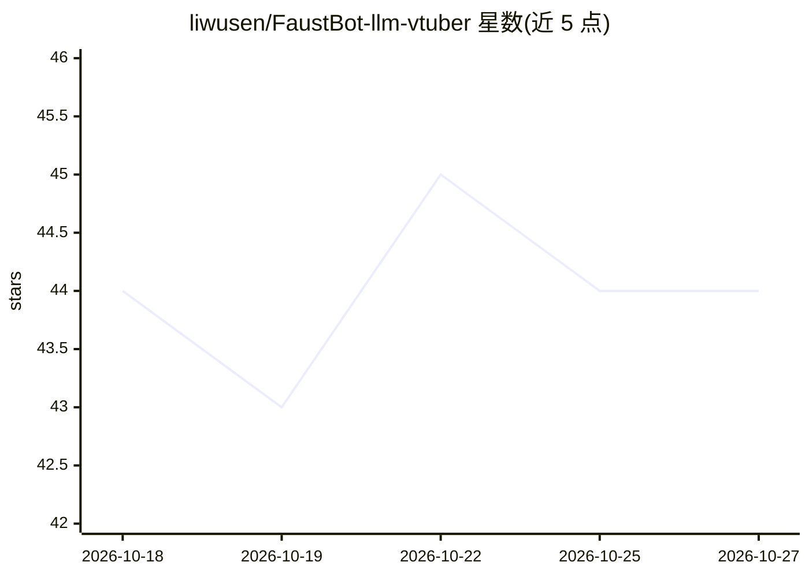

# liwusen/FaustBot-llm-vtuber

⭐ 44 · Python · GPL-3.0 · 推送 2026-10-25 · [GitHub](https://github.com/liwusen/FaustBot-llm-vtuber) · [官网](https://faustbot.allenlee.xyz) · 个人维护 · 中文 README

**会自我进化的桌面 AI 伙伴/Vtuber，可直播与唱歌**

AI 驱动的 Vtuber / 桌面伙伴应用：基于 LangGraph 的 Agent 可派发子代理、定时自醒、读屏幕、操作浏览器、玩《我的世界》，通过 Agile Engine 在运行期自己编写模块扩展能力。具备三合一混合长期记忆（向量+BM25+知识图谱）与 Araya 自动记忆维护代理、UVR/Seed-VC 歌曲翻唱、B 站直播接入、Live2D/图片自定义形象、插件与 Skill 市场、MCP 客户端。后端 Python + Electron 前端，Windows 提供一键安装包；自我进化功能标注为实验性。

## 筛选速览

| 维度 | 判定 | 备注 |
|---|---|---|
| AI 角色 | `ai-native` | 本体是模型或模型工具 |
| 许可风险 | `viral` | GPL-3.0 |
| 部署形态 | `library` | 以包/库形式分发 |
| 模型依赖 | — | README 未给出锁定关系 |
| 硬件要求 | — | 无带数字的原话,不猜 |
| 安装摩擦 | `low` | 无编译、无系统依赖或容器化 |
| 成熟度 | `idea` | |

## 能力要点

- Agile Engine：Agent 运行期自行编写轻量模块扩展能力
- 向量+BM25+知识图谱三合一长期记忆，Araya 代理空闲时自动整理
- B 站直播接入，接收弹幕实时回应，支持黑名单过滤
- UVR 人声分离 + Seed-VC 音色转换实现歌曲翻唱

## 适用场景

- 桌面常驻一个可对话、会记住我的习惯并主动搭话的 AI 伙伴
- 让 AI 替我在 B 站做虚拟主播、回应弹幕
- 点歌后用自定义音色翻唱给我听

## 场景标签

`AI 助手` `聊天机器人` `语音合成` · 领域:对话与助手

## 证据(README 行号)

> L18: FaustBot 是一个 AI 驱动的 Vtuber / 桌面伙伴。她会用自己的声音唱歌、在你桌面上弹出小窗口和你玩游戏、留意你正在听什么歌或熬到多晚然后主动开口，还能替你上 B 站直播当主播。她记得住你说过的事，甚至会在你休息时
> L63: FaustBot 的底层是基于 Langgraph 构建的代理,架构设计与主流Coding Agent接近：
> L160: FaustBot已经为Windows准备了安装包,无需折腾,一键开用

## 星数曲线

2026-10-18 44 → 2026-10-27 44（+0）

---
*卡片 v1 · prompt 1.4 · 生成 2026-10-25 · 置信度 mid · 依据 README sha `d54cde71a989` · [字段定义](../../DATASET.md)*
