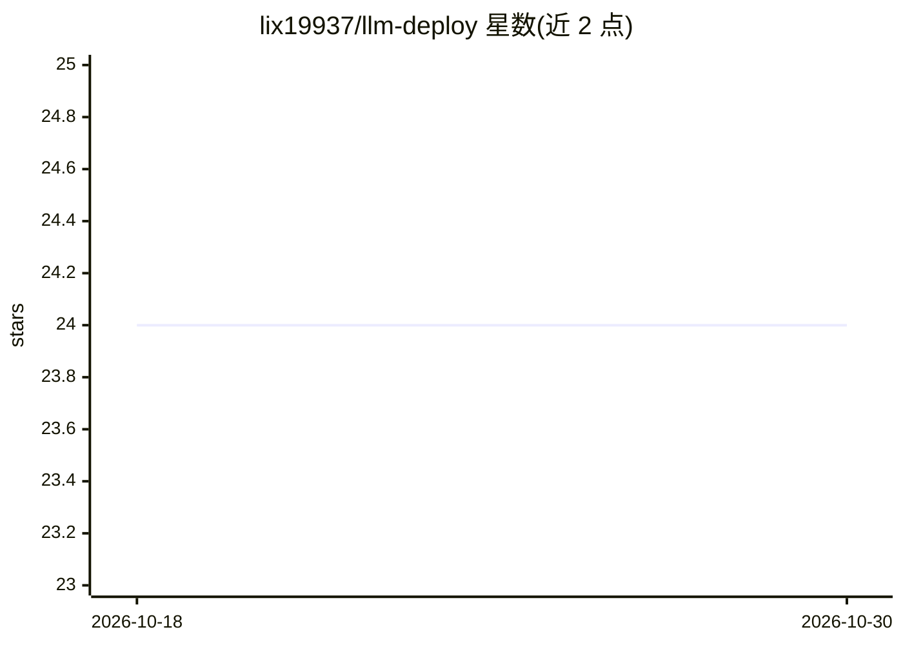

# lix19937/llm-deploy

⭐ 24 · Python · 推送 2026-08-10 · [GitHub](https://github.com/lix19937/llm-deploy) · 个人维护 · 中文 README

**LLM 推理加速技术知识整理：概念、指标、优化原理笔记**

以中文笔记形式整理 LLM 推理加速相关知识：涵盖 LLM 基本概念与解码策略、Latency/Throughput 指标及 trade-off、KV Cache 量化分析、Prefill/Decoding 两阶段过程、计算约束与内存约束的判断方法，以及算子融合、量化、batch 推理、FlashAttention 等底层优化原理。另以表格梳理 FasterTransformer、DeepSpeed、llama.cpp、vLLM、FlexGen 等主流加速框架的方法与出处。内容为文档型知识汇总，无安装运行的产品本体。

## 筛选速览

| 维度 | 判定 | 备注 |
|---|---|---|
| AI 角色 | `ai-knowledge` | 知识聚合/清单类 |
| 许可风险 | `none` | — |
| 部署形态 | `None` |  |
| 模型依赖 | — | README 未给出锁定关系 |
| 硬件要求 | — | 无带数字的原话,不猜 |
| 安装摩擦 | `medium` | 含编译或系统依赖之一 |
| 成熟度 | — | 结构信号不足 |

## 能力要点

- 整理 Latency/Throughput 指标定义与 batch_size trade-off
- 给出 KV Cache 显存占用的量化公式与 OPT-175B 估算
- 以表格对比 FasterTransformer/DeepSpeed/llama.cpp/vLLM/FlexGen 等框架
- 解释算子融合、量化、FlashAttention 等优化底层原理

## 适用场景

- 学习 LLM 推理加速的核心概念与优化原理
- 选型前对比主流推理加速框架的定位与方法
- 理解 KV Cache、compute-bound 与 memory-bound 等基础机制

## 场景标签

`教程课程` · 领域:学习与行业

## 证据(README 行号)

> L1: ## LLM 推理加速
> L72: ### 一些主流加速框架
> L112: ## 主流优化方案的底层原理

## 星数曲线

2026-10-18 24 → 2026-10-30 24（+0）

---
*卡片 v1 · prompt 1.4 · 生成 2026-10-27 · 置信度 high · 依据 README sha `02f5f91aa67c` · [字段定义](../../DATASET.md)*
