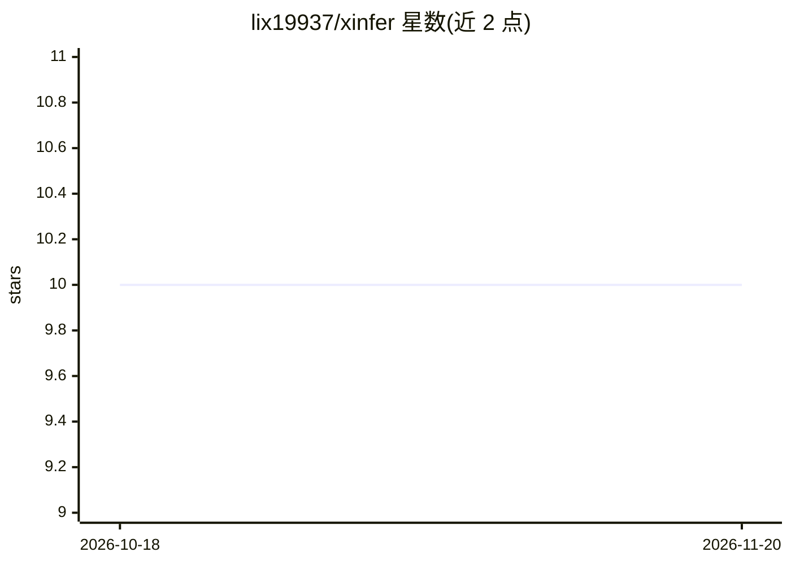

# lix19937/xinfer

⭐ 10 · C++ · MIT · 推送 2026-07-06 · [GitHub](https://github.com/lix19937/xinfer) · 个人维护 · 中文 README

**C++ 推理引擎：解析 ONNX 并在 CPU/GPU 上编译执行推理**

以 C++17 实现的神经网络推理引擎，含单级 SSA IR、静态图模式与细粒度算子。通过 parser 模块读取 ONNX 输入并导出为 json/MessagePack 中间表示，编译层提供算子融合、常量折叠、死代码消除与图着色式内存复用等优化，后端支持 CPU/GPU 执行 CNN 模型并支持 dynamic shape。附带类 trtexec 命令行工具，提供 compile、run、perf、verify 等模型编译、推理与性能分析子命令。当前不支持 LLM、torch 输入与 OpenAI/Triton 服务接口。

## 筛选速览

| 维度 | 判定 | 备注 |
|---|---|---|
| AI 角色 | `ai-native` | 本体是模型或模型工具 |
| 许可风险 | `permissive` | MIT |
| 部署形态 | `None` |  |
| 模型依赖 | — | README 未给出锁定关系 |
| 硬件要求 | — | 无带数字的原话,不猜 |
| 安装摩擦 | `low` | 无编译、无系统依赖或容器化 |
| 成熟度 | — | 结构信号不足 |

## 能力要点

- 解析 ONNX 输入，IR 可导出为 json/MessagePack 文件
- 编译优化：算子融合、常量折叠、内存复用、指令调度
- CPU/GPU 双后端，支持 dynamic shape 与 CNN
- 类 trtexec 命令行工具：compile/run/perf/verify

## 适用场景

- 在 CPU 或 GPU 上离线编译并执行 ONNX 格式的 CNN 模型
- 对模型做性能分析、显存占用统计与输出一致性校验
- 基于其 IR 与 passes 接口做图优化实验

## 场景标签

`推理引擎` · 领域:训练与推理

## 证据(README 行号)

> L1: # xinfer 推理引擎
> L14: - [x] 支持 onnx输入
> L35: |target|支持的硬件平台，CPU和GPU，在编译模型的时候，需要指定一个target|

## 星数曲线

2026-10-18 10 → 2026-11-20 10（+0）

---
*卡片 v1 · prompt 1.4 · 生成 2026-11-19 · 置信度 mid · 依据 README sha `51e6b97eeded` · [字段定义](../../DATASET.md)*
