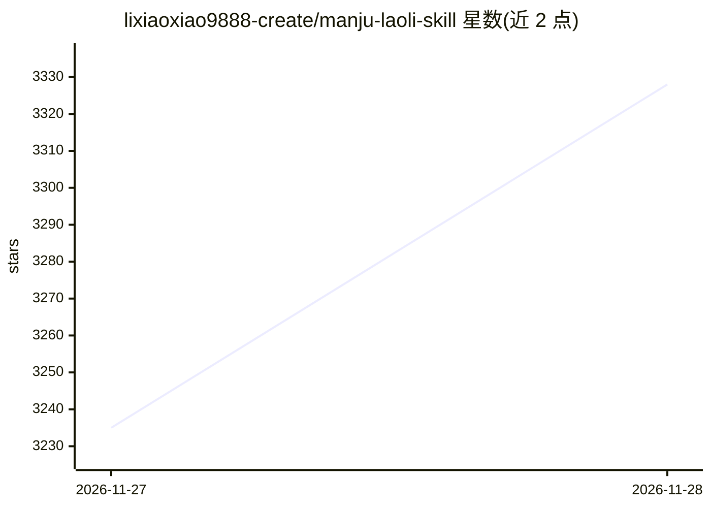

# lixiaoxiao9888-create/manju-laoli-skill

⭐ 3,328 · Python · MIT · 推送 2026-11-26 · [GitHub](https://github.com/lixiaoxiao9888-create/manju-laoli-skill) · 个人维护 · 中文 README

**给 AIGC 创作者的短剧/漫剧全流程 AI Agent 技能包**

一套由 1 个总控（short-drama-director）与 10 个子技能组成的 OpenClaw Skill 规则库，面向 AIGC 短剧/漫剧/广告片创作：用户回答素材来源、模型版本、画幅等 5 个问题，总控内部执行五道前置锁、子技能路由、七段式提示词生成与 C1~C41 机检。本包不持有图片，交付提示词与《素材接线单》，图由用户在即梦/Seedance/豆包等平台生成。视频模型线仅支持 Seedance 2.5/2.0 二选一，测试版，由二次修改整合开源内容而来。

## 筛选速览

| 维度 | 判定 | 备注 |
|---|---|---|
| AI 角色 | `ai-native` | 本体是模型或模型工具 |
| 许可风险 | `permissive` | MIT |
| 部署形态 | `None` |  |
| 模型依赖 | — | README 未给出锁定关系 |
| 硬件要求 | — | 无带数字的原话,不猜 |
| 安装摩擦 | `low` | 无编译、无系统依赖或容器化 |
| 成熟度 | — | 结构信号不足 |

## 能力要点

- 1 总控 + 10 子技能四层架构，53 份规则库，机检 C1~C41 与投喂闸门 G1~G8
- 五道前置锁 + I 画风锁：未指定必须停下询问，禁止默认跳过
- Asset-First 资产锁定（场景五宫格、站位方案 C+/C++）防跨镜角色漂移
- 输出七段式投喂提示词组 + 素材接线单，素材形态分 M0/M1/M2 三档

## 适用场景

- 制作 AI 短剧/漫剧，从一句话需求到可直接投喂视频模型的提示词
- AI 广告片、概念片的剧本、分镜与资产一致性管理
- 武打/动作场面的分镜设计与预演
- 需要跨镜头角色一致性的 AI 视频生产

## 场景标签

`提示工程` `视频生成` · 领域:Agent 开发

## 证据(README 行号)

> L28: 一套**给 AI 助手执行的 AIGC 全流程创作规则库**（OpenClaw Skill / Agent 技能包）。不是一份长提示词，而是一套**可路由、可挂载、可机检**的导演系统：**1 个总控**（`short-drama
> L143: |**Agent 平台**|OpenClaw · WorkBuddy · 豆包智能体 / 扣子（Coze）· Dify 及通用 LLM（支持豆包 JSON 分块，防上下文截断）|
> L144: |**视频模型**|**Seedance 2.5 / 2.0**（强制二选一，语法契约彻底分流；**包内唯一模型线**）|

## 星数曲线

2026-11-27 3,235 → 2026-11-28 3,328（+93）

---
*卡片 v1 · prompt 1.4 · 生成 2026-11-27 · 置信度 high · 依据 README sha `6f7a80dfed02` · [字段定义](../../DATASET.md)*
