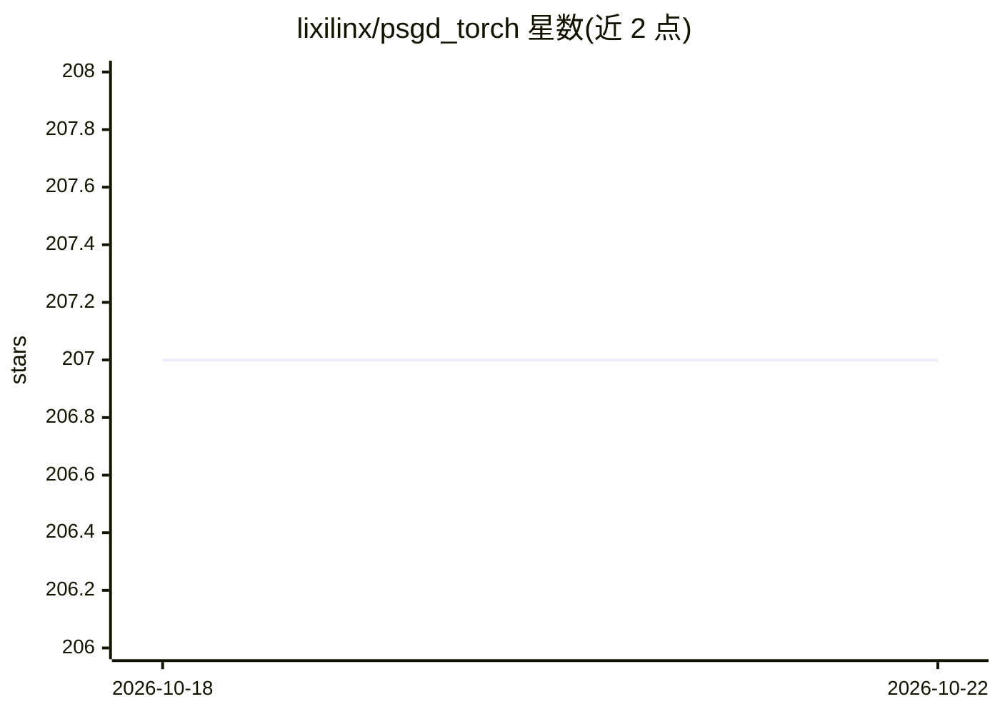

# lixilinx/psgd_torch

⭐ 207 · Python · 推送 2026-05-30 · [GitHub](https://github.com/lixilinx/psgd_torch) · 个人维护

**面向研究者的 PyTorch 二阶优化器 PSGD 实现库**

提供 preconditioned SGD 的 PyTorch 实现：将预条件子估计与 Hessian 拟合表述为强凸 Lie 群流形优化问题，支持 Kronecker、affine、低秩近似（LRA）、稠密等多种预条件子，以及梯度/动量白化与 Hvp 拟合。底层函数式 API 封装为 KronWhiten/Newton、LRAWhiten/Newton、DenseNewton 类，与 torch.optim.SGD 的差异包括以闭包传入损失、动量与学习率解耦、不含内置权重衰减。提供 Rosenbrock、ViT、GPT2 等示例；除 Kronecker 预条件子外不原生支持复数参数优化。

## 筛选速览

| 维度 | 判定 | 备注 |
|---|---|---|
| AI 角色 | `ai-ecosystem` | LLM/agent 周边工具 |
| 许可风险 | `none` | — |
| 部署形态 | `None` |  |
| 模型依赖 | — | README 未给出锁定关系 |
| 硬件要求 | — | 无带数字的原话,不猜 |
| 安装摩擦 | `low` | 无编译、无系统依赖或容器化 |
| 成熟度 | — | 结构信号不足 |

## 能力要点

- Table II 列出多种 Lie 群预条件子及其存储/计算复杂度
- 默认 dQ 更新恢复带稳定性保证的 Newton-Schulz 迭代
- 提供 DDP/FSDP 封装示例与函数式 API 两层接口
- 示例含 Rosenbrock、ViT、GPT2、张量秩分解等

## 适用场景

- 在 PyTorch 训练中以二阶预条件优化器替代 SGD/Adam
- 稀疏梯度场景下做动量白化（如 GPT2 训练）
- 自定义 Hessian 拟合与预条件子几何的研究实验

## 场景标签

 · 领域:深度学习/优化算法

## 证据(README 行号)

> L4: PSGD (Preconditioned SGD) is a general purpose (mathematical and stochastic, convex and nonconvex) 2nd order optimiz
> L61: These functional APIs are lightly wrapped into classes *KronWhiten/Newton*, *LRAWhiten/Newton* and *DenseNewton* fo

## 星数曲线

2026-10-18 207 → 2026-10-22 207（+0）

---
*卡片 v1 · prompt 1.4 · 生成 2026-10-22 · 置信度 high · 依据 README sha `bb7191bc21b1` · [字段定义](../../DATASET.md)*
