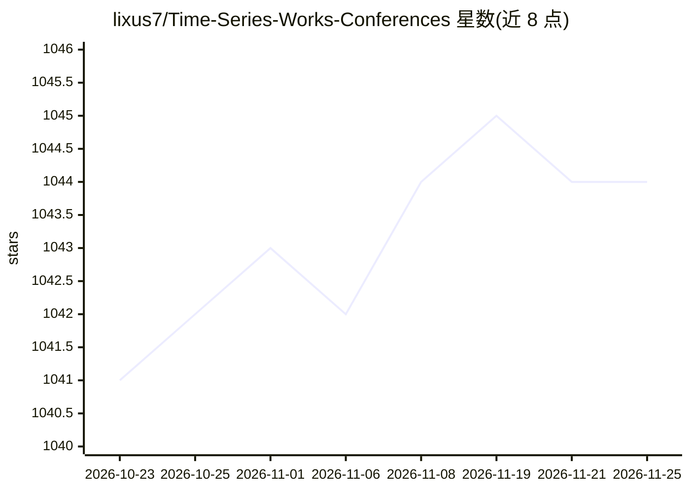

# lixus7/Time-Series-Works-Conferences

⭐ 1,044 · MIT · 推送 2026-11-18 · [GitHub](https://github.com/lixus7/Time-Series-Works-Conferences) · 个人维护

**面向时序研究者的 CS 顶会论文分类清单**

由 UNSW 博士生维护的时间序列研究论文汇总，按任务分类组织（多变量预测、概率预测、缺失值填补、异常检测、需求预测、生成、行程时间估计等 11 类），条目以表格形式记录任务、数据集、模型、论文标题、代码与会议出处（NIPS、ICML、ICLR、KDD、AAAI 等）。README 目前主要覆盖多变量时序预测一类，其余任务为待补充的目录框架。

## 筛选速览

| 维度 | 判定 | 备注 |
|---|---|---|
| AI 角色 | `ai-knowledge` | 知识聚合/清单类 |
| 许可风险 | `permissive` | MIT |
| 部署形态 | `None` |  |
| 模型依赖 | — | README 未给出锁定关系 |
| 硬件要求 | — | 无带数字的原话,不猜 |
| 安装摩擦 | `low` | 无编译、无系统依赖或容器化 |
| 成熟度 | — | 结构信号不足 |

## 能力要点

- 按 11 类时序任务组织论文条目
- 表格字段含任务、数据、模型、论文、代码、会议出处
- 覆盖 ICML/ICLR/NIPS/KDD/AAAI 等会议

## 适用场景

- 查找某类时序预测任务的顶会论文
- 跟进时序基础模型相关研究进展
- 为文献综述收集论文与代码线索

## 场景标签

`科研工具` `精选清单` · 领域:学习与行业

## 证据(README 行号)

> L13: # Recent Time Series Works Grouped by Task
> L28: |Task|Data|Model|Paper|Code|Publication|

## 星数曲线

2026-10-23 1,041 → 2026-11-25 1,044（+3）

---
*卡片 v1 · prompt 1.4 · 生成 2026-11-24 · 置信度 high · 依据 README sha `725474a16dc7` · [字段定义](../../DATASET.md)*
