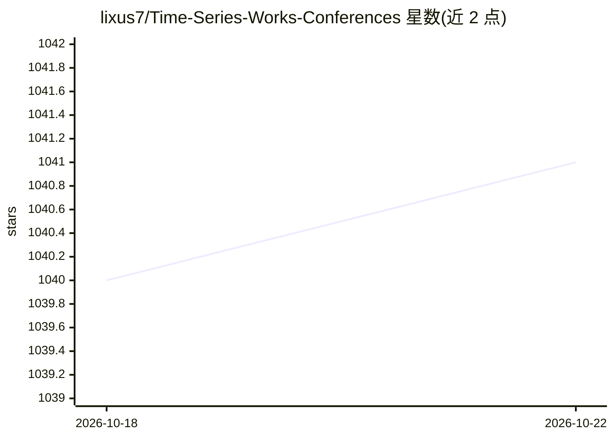

# lixus7/Time-Series-Works-Conferences

⭐ 1,041 · MIT · 推送 2026-09-29 · [GitHub](https://github.com/lixus7/Time-Series-Works-Conferences) · 个人维护

**顶会时间序列论文追踪清单，供研究者跟进最新工作**

由 UNSW 在读博士生维护的时间序列论文聚合清单，按任务分栏收录 CS 顶会（ICML/ICLR/NeurIPS/KDD/AAAI 等）的时序研究论文，条目以表格形式列出任务类型、数据集、模型名、论文与代码链接及发表会议，覆盖多变量预测、概率预测、插补、异常检测、时序生成、出行时间估计、事件与股票预测等方向，并收录时序基础模型（TSFM）与 LLM+时序相关工作。纯清单仓库，无安装运行内容。

## 筛选速览

| 维度 | 判定 | 备注 |
|---|---|---|
| AI 角色 | `ai-knowledge` | 知识聚合/清单类 |
| 许可风险 | `permissive` | MIT |
| 部署形态 | `None` |  |
| 模型依赖 | — | README 未给出锁定关系 |
| 硬件要求 | — | 无带数字的原话,不猜 |
| 安装摩擦 | `low` | 无编译、无系统依赖或容器化 |
| 成熟度 | — | 结构信号不足 |

## 能力要点

- 按 10 余个时序任务分类组织论文条目
- 表格含任务、数据集、模型、论文、代码、发表会议字段
- 跟踪时序基础模型（TSFM）与 LLM 时序方向

## 适用场景

- 跟进顶会最新时间序列论文与开源代码
- 按任务方向检索可用模型与基准数据集
- 了解时序基础模型研究动态

## 场景标签

`精选清单` · 领域:学习与行业

## 证据(README 行号)

> L7: My research is driven by a strong passion for **Time-Series Research and Deep Learning**. Currently, my work focuses
> L13: # Recent Time Series Works Grouped by Task
> L27: # Multivariat Time Series Forecasting

## 星数曲线

2026-10-18 1,040 → 2026-10-22 1,041（+1）

---
*卡片 v1 · prompt 1.4 · 生成 2026-10-21 · 置信度 high · 依据 README sha `22c0393d04b5` · [字段定义](../../DATASET.md)*
