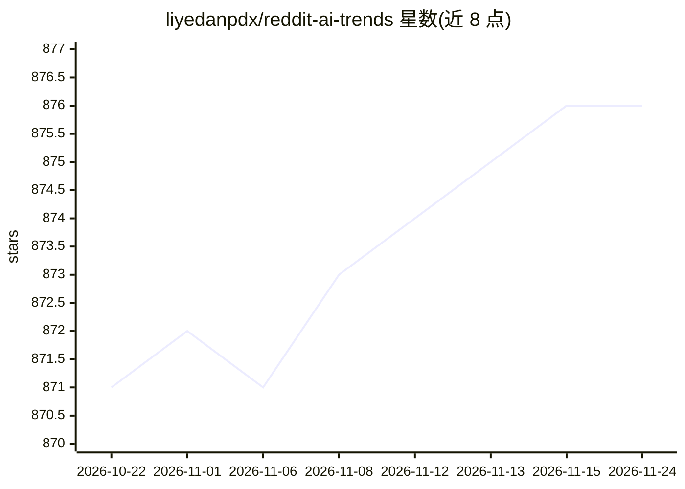

# liyedanpdx/reddit-ai-trends

⭐ 876 · Python · MIT · 推送 2026-11-22 · [GitHub](https://github.com/liyedanpdx/reddit-ai-trends) · 个人维护 · 中文 README

**自动抓取 Reddit 中英文 AI 社区并生成每日趋势报告的工具**

通过 Reddit 官方 API 抓取多个 AI 相关子版块帖子，调用 Groq 或 OpenRouter 的 LLM（含 DeepSeek）分析帖子、总结讨论并追踪趋势，按年/月/日目录生成中英文双语报告，含今日要点、周趋势对比、月度技术演进等内容。支持视觉模型分析帖内图片、YouTube 视频转写摘要、Firecrawl 网页抓取。以 Docker Compose 或手动 pip 运行，需自备 Reddit API 凭据与 LLM API key，数据存入 MongoDB。

## 筛选速览

| 维度 | 判定 | 备注 |
|---|---|---|
| AI 角色 | `ai-native` | 本体是模型或模型工具 |
| 许可风险 | `permissive` | MIT |
| 部署形态 | `self-host` | docker 或自建部署 |
| 模型依赖 | locked-api |  |
| 硬件要求 | — | 无带数字的原话,不猜 |
| 安装摩擦 | `low` | 无编译、无系统依赖或容器化 |
| 成熟度 | — | 结构信号不足 |

## 能力要点

- 中英文双语 Reddit AI 社区监控与每日报告生成
- 多模态富化：视觉模型图片分析、YouTube 转写、Firecrawl 网页摘要
- Groq 与 OpenRouter 多 LLM 接入，支持数据库缓存降低 API 成本
- Docker Compose 一键部署与定时生成（--interval）

## 适用场景

- 每天自动追踪 Reddit 上新兴 AI 技术讨论与热门话题
- 以双语报告了解中英文 AI 社区各自的关注点差异
- 对比当前与历史趋势数据发现新兴模式

## 场景标签

`网页抓取` · 领域:效率与自动化

## 证据(README 行号)

> L5: Automatically generate trend reports from AI-related Reddit communities, supporting both English and Chinese languag
> L23: - **Multiple LLM Providers**: Supports both Groq and OpenRouter APIs
> L89: ### Deploy with Docker Compose

## 星数曲线

2026-10-22 871 → 2026-11-24 876（+5）

---
*卡片 v1 · prompt 1.4 · 生成 2026-11-24 · 置信度 high · 依据 README sha `e4c7880449e7` · [字段定义](../../DATASET.md)*
