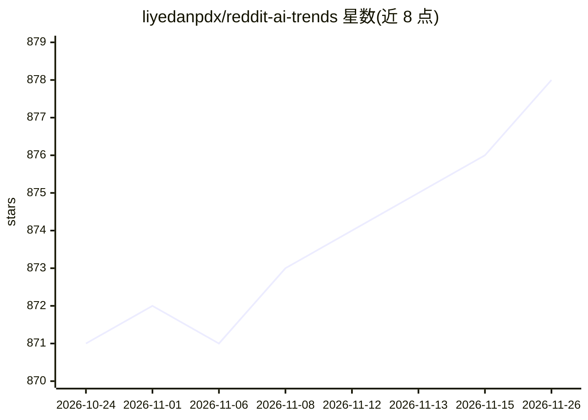

# liyedanpdx/reddit-ai-trends

⭐ 878 · Python · MIT · 推送 2026-11-24 · [GitHub](https://github.com/liyedanpdx/reddit-ai-trends) · 个人维护 · 中文 README

**自动扫描 Reddit 中英文 AI 社区并生成每日趋势报告**

基于 Reddit 官方 API 抓取 AI 相关子版块的帖子与评论，调用 Groq/OpenRouter 的 LLM 进行总结与趋势分析，按年/月/日目录生成中英双语报告，含当日要点、周对比、月度技术演进等章节。扩展功能包括视觉模型分析帖内图片、YouTube 字幕提取、Firecrawl 网页摘要，均有数据库缓存以降低 API 调用，且可通过 .env 全部选配。部署依赖 Docker Compose 与 MongoDB，需自备 Reddit API 凭据和 LLM API key。

## 筛选速览

| 维度 | 判定 | 备注 |
|---|---|---|
| AI 角色 | `ai-native` | 本体是模型或模型工具 |
| 许可风险 | `permissive` | MIT |
| 部署形态 | `self-host` | docker 或自建部署 |
| 模型依赖 | locked-api |  |
| 硬件要求 | — | 无带数字的原话,不猜 |
| 安装摩擦 | `low` | 无编译、无系统依赖或容器化 |
| 成熟度 | — | 结构信号不足 |

## 能力要点

- 扫描多个 AI 相关 subreddit 并聚合中英文双语报告
- 支持 Groq 与 OpenRouter 双 LLM 通道（可访问 DeepSeek/Gemini/Qwen 等）
- 可选富化管道：Qwen-VL/Gemini 图像分析、YouTube 字幕、Firecrawl 网页摘要
- 数据库缓存富化结果与 Docker Compose 一键部署

## 适用场景

- 每天自动追踪 Reddit 上 AI 社区的热点话题
- 监控小众 AI 社区里可能被忽略的讨论
- 生成中英双语趋势报告做长期对比分析

## 场景标签

`网页抓取` `数据分析` · 领域:效率与自动化

## 证据(README 行号)

> L5: Automatically generate trend reports from AI-related Reddit communities, supporting both English and Chinese languag
> L23: - **Multiple LLM Providers**: Supports both Groq and OpenRouter APIs

## 星数曲线

2026-10-24 871 → 2026-11-26 878（+7）

---
*卡片 v1 · prompt 1.4 · 生成 2026-11-25 · 置信度 high · 依据 README sha `f93f4bd336e5` · [字段定义](../../DATASET.md)*
