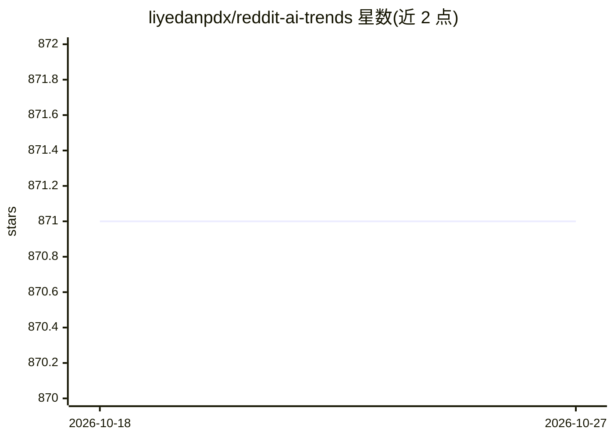

# liyedanpdx/reddit-ai-trends

⭐ 871 · Python · MIT · 推送 2026-10-26 · [GitHub](https://github.com/liyedanpdx/reddit-ai-trends) · 个人维护 · 中文 README

**自动扫描 Reddit AI 社区并用 LLM 生成双语趋势日报**

定时抓取多个 AI 相关 subreddit 的帖子，调用 LLM（Groq 或 OpenRouter 通道，含 DeepSeek 等）做摘要与趋势分析，生成中英双语日报，存入年/月/日目录并自动更新 README 链接。支持图像视觉模型分析（Qwen-VL、Gemini）、YouTube 字幕提取、Firecrawl 网页抓取摘要与评论整合，均有数据库缓存以降低 API 成本；数据持久化到 MongoDB。部署方式为 Docker Compose 或手动 pip 安装运行，需自备 Reddit API 凭据与 LLM API key。

## 筛选速览

| 维度 | 判定 | 备注 |
|---|---|---|
| AI 角色 | `ai-native` | 本体是模型或模型工具 |
| 许可风险 | `permissive` | MIT |
| 部署形态 | `self-host` | docker 或自建部署 |
| 模型依赖 | locked-api |  |
| 硬件要求 | — | 无带数字的原话,不猜 |
| 安装摩擦 | `low` | 无编译、无系统依赖或容器化 |
| 成熟度 | — | 结构信号不足 |

## 能力要点

- Reddit 多社区采集 + LLM 分析生成中英双语日报
- 图像（Qwen-VL/Gemini）、YouTube 字幕、网页内容的可选富化分析
- 数据库缓存所有富化结果以减少 API 调用，MongoDB 持久化
- Docker Compose 一键部署，报告按年/月/日组织并自动更新链接

## 适用场景

- 每日自动生成 AI 领域趋势报告，跟踪新技术讨论
- 对比周/月趋势，发现小众社区中被忽略的讨论
- 中英双语获取 AI 社区动态摘要

## 场景标签

`网页抓取` `AI 写作` · 领域:效率与自动化

## 证据(README 行号)

> L5: Automatically generate trend reports from AI-related Reddit communities, supporting both English and Chinese languag
> L21: - **Detailed Trend Analysis**: Generate in-depth reports including today's highlights, weekly trend comparisons, mo
> L23: - **Multiple LLM Providers**: Supports both Groq and OpenRouter APIs

## 星数曲线

2026-10-18 871 → 2026-10-27 871（+0）

---
*卡片 v1 · prompt 1.4 · 生成 2026-10-21 · 置信度 high · 依据 README sha `83e8b87d67d0` · [字段定义](../../DATASET.md)*
