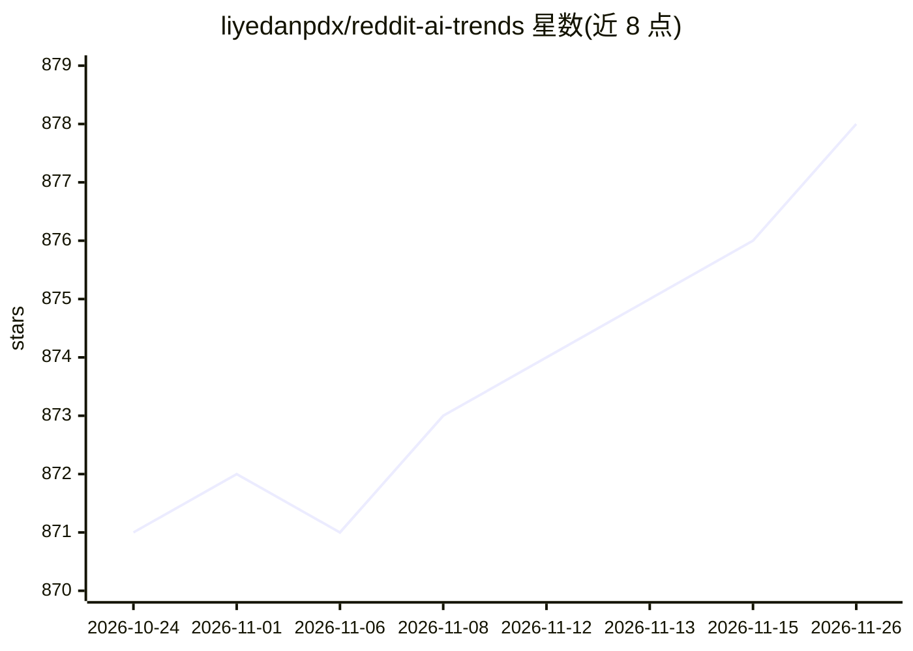

# liyedanpdx/reddit-ai-trends

⭐ 878 · Python · MIT · 推送 2026-11-24 · [GitHub](https://github.com/liyedanpdx/reddit-ai-trends) · 个人维护

**扫描 Reddit AI 社区并用 LLM 生成中英文每日趋势报告的工具**

通过 Reddit 官方 API 抓取多个 AI 相关 subreddit 的帖子，调用 LLM（经 Groq 或 OpenRouter）分析帖子内容，生成包含当日要点、周度趋势对比、月度技术演进的报告，支持中英文双语输出。增强功能包括视觉模型分析帖子图片（Qwen-VL、Gemini）、YouTube 视频转录摘要、Firecrawl 网页内容抓取摘要、社区评论整合与机器人过滤；所有增强数据经数据库缓存以降低 API 成本。部署依赖 Docker/MongoDB 与 Reddit API 凭据，报告按年/月/日目录存储并自动更新 README 链接。

## 筛选速览

| 维度 | 判定 | 备注 |
|---|---|---|
| AI 角色 | `ai-native` | 本体是模型或模型工具 |
| 许可风险 | `permissive` | MIT |
| 部署形态 | `self-host` | docker 或自建部署 |
| 模型依赖 | — | README 未给出锁定关系 |
| 硬件要求 | — | 无带数字的原话,不猜 |
| 安装摩擦 | `low` | 无编译、无系统依赖或容器化 |
| 成熟度 | — | 结构信号不足 |

## 能力要点

- 扫描多个 AI 相关 subreddit，生成中英文双语趋势报告
- 支持 Groq 与 OpenRouter 双通道，可访问 DeepSeek/Gemini/Qwen 等模型
- 视觉模型图片分析、YouTube 转录、Firecrawl 网页摘要等可选增强器
- 数据库缓存增强结果，报告按年/月/日目录组织

## 适用场景

- 每天自动跟踪 Reddit AI 社区的热门话题
- 对比历史数据发现新兴 AI 技术趋势
- 同时获取中英文社区的讨论摘要

## 场景标签

`网页抓取` `AI 写作` · 领域:效率与自动化

## 证据(README 行号)

> L5: Automatically generate trend reports from AI-related Reddit communities, supporting both English and Chinese languag
> L23: - **Multiple LLM Providers**: Supports both Groq and OpenRouter APIs

## 星数曲线

2026-10-24 871 → 2026-11-26 878（+7）

---
*卡片 v1 · prompt 1.4 · 生成 2026-11-26 · 置信度 high · 依据 README sha `94b66d599941` · [字段定义](../../DATASET.md)*
