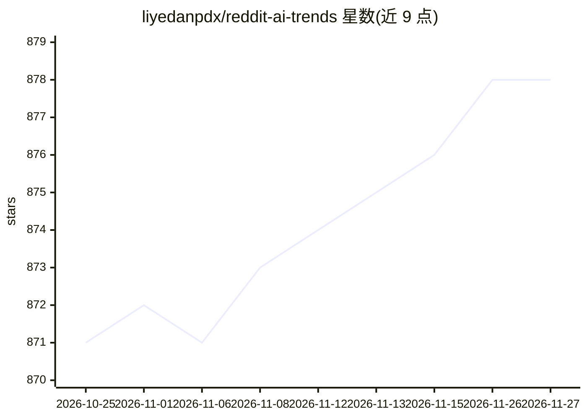

# liyedanpdx/reddit-ai-trends

⭐ 878 · Python · MIT · 推送 2026-11-26 · [GitHub](https://github.com/liyedanpdx/reddit-ai-trends) · 个人维护

**自动抓取 Reddit AI 社区并用 LLM 生成中英双语趋势日报**

通过 Reddit 官方 API 采集多个 AI 相关子版块帖子，调用 Groq 或 OpenRouter 的 LLM（含 DeepSeek、Gemini、Qwen 等模型）分析并生成日报，按年/月/日目录存储，支持周度对比与月度技术演进分析。扩展功能包括视觉模型（Qwen-VL、Gemini）解析帖内图片、YouTube 字幕提取、Firecrawl 网页摘要、评论集成与机器人过滤；所有增强数据均有数据库缓存以降低 API 成本，增强功能均可通过 .env 配置开关。部署需 Docker 与 MongoDB，需自备 Reddit API 凭据与 LLM API key。

## 筛选速览

| 维度 | 判定 | 备注 |
|---|---|---|
| AI 角色 | `ai-native` | 本体是模型或模型工具 |
| 许可风险 | `permissive` | MIT |
| 部署形态 | `self-host` | docker 或自建部署 |
| 模型依赖 | locked-api |  |
| 硬件要求 | — | 无带数字的原话,不猜 |
| 安装摩擦 | `low` | 无编译、无系统依赖或容器化 |
| 成熟度 | — | 结构信号不足 |

## 能力要点

- 扫描中英文 AI 社区并生成每日趋势排名报告
- 支持多 LLM 提供方（Groq、OpenRouter）及视觉模型（Qwen-VL、Gemini）
- YouTube 字幕、网页内容、社区评论多源增强分析
- Docker 部署，MongoDB 持久化与数据库缓存

## 适用场景

- 每天自动跟踪 AI 社区热点话题
- 对比周度/月度趋势发现新兴技术动向
- 以中英文双语生成并归档趋势报告

## 场景标签

`网页抓取` `数据分析` · 领域:效率与自动化

## 证据(README 行号)

> L5: Automatically generate trend reports from AI-related Reddit communities, supporting both English and Chinese languag
> L23: - **Multiple LLM Providers**: Supports both Groq and OpenRouter APIs
> L28: - **MongoDB Persistence**: Store all data for historical analysis

## 星数曲线

2026-10-25 871 → 2026-11-27 878（+7）

---
*卡片 v1 · prompt 1.4 · 生成 2026-11-27 · 置信度 high · 依据 README sha `27be03886765` · [字段定义](../../DATASET.md)*
