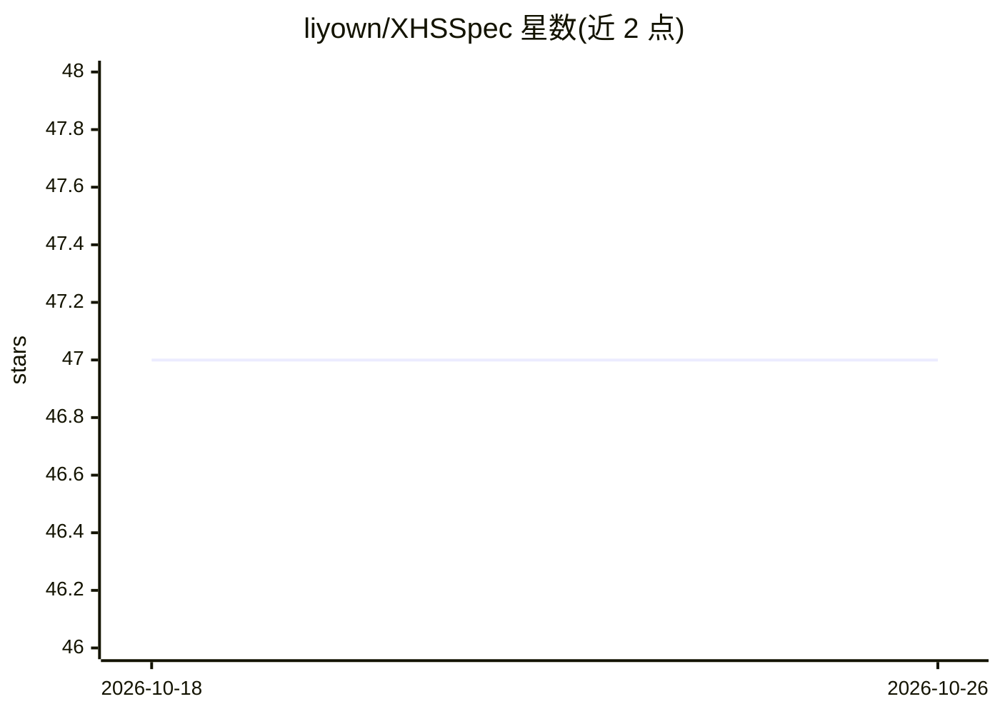

# liyown/XHSSpec

⭐ 47 · TypeScript · 推送 2026-03-13 · [GitHub](https://github.com/liyown/XHSSpec) · [官网](https://liyown.github.io/XHSSpec/) · 个人维护 · 中文 README

**规范驱动 AI 编码工具的小红书内容运营系统**

repo-first、spec-driven 的小红书内容工作流框架：以 brand/strategy 文件保存账号定位等长期上下文，通过 slash command 在 Claude Code、Codex、Cursor、VS Code 等 AI 编码工具中驱动 agent 执行 quick/hot/plan 等工作流，产出 brief、draft、review、publish 包（含 note.md、first-screen.md、demo.html 等）并归档经验写回 repo。CLI 负责初始化与确定性动作，前台体验发生在 AI 工具内。面向技术创作者、独立开发者与技术品牌团队。需先补齐 5 个 brand 定位文件。

## 筛选速览

| 维度 | 判定 | 备注 |
|---|---|---|
| AI 角色 | `ai-ecosystem` | LLM/agent 周边工具 |
| 许可风险 | `none` | — |
| 部署形态 | `None` |  |
| 模型依赖 | — | README 未给出锁定关系 |
| 硬件要求 | — | 无带数字的原话,不猜 |
| 安装摩擦 | `low` | 无编译、无系统依赖或容器化 |
| 成熟度 | — | 结构信号不足 |

## 能力要点

- brand/strategy 文件保存长期账号定位上下文
- 7 个 slash command 驱动 quick/trend/campaign 三类工作流
- publish 生成含 note.md、demo.html、posting-guide.md 的发布包
- 每次运行产出 brief/draft/review/publish/retrospective/knowledge 归档

## 适用场景

- 把临时选题对话变成可归档可续写的内容系统
- 让 AI agent 按账号定位规范产出小红书文案与封面方案
- 做周系列/月主题的多篇内容规划与经验沉淀

## 场景标签

`工作流自动化` `AI 写作` `Agent 框架` · 领域:Agent 开发

## 证据(README 行号)

> L3: > 在 Claude Code、Codex、Cursor、VS Code 这类 AI 编码环境里，把小红书运营变成一个可复用、可归档、可续写的内容系统。
> L41: XHSSpec 会给你的 AI 工具一套完整的小红书工作流：
> L83: ## 真正的前台不是 CLI，而是 Slash Command

## 星数曲线

2026-10-18 47 → 2026-10-26 47（+0）

---
*卡片 v1 · prompt 1.4 · 生成 2026-10-25 · 置信度 high · 依据 README sha `6cc845ea08e7` · [字段定义](../../DATASET.md)*
