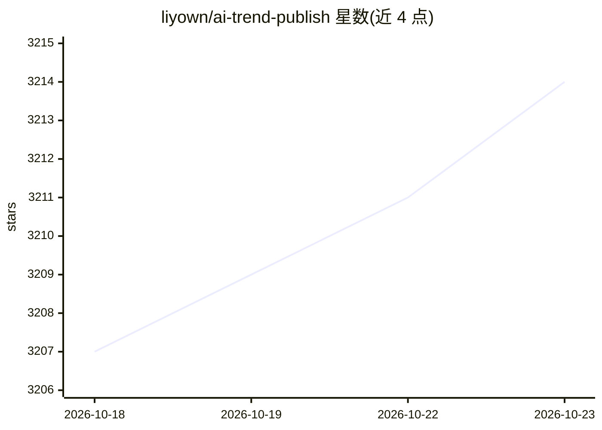

# liyown/ai-trend-publish

⭐ 3,214 · TypeScript · MIT · 推送 2026-08-04 · [GitHub](https://github.com/liyown/ai-trend-publish) · [官网](https://liyown.github.io/ai-trend-publish/) · 个人维护 · 中文 README

**微信公众号自动化选题与发布系统，AI 全流程生成文章**

基于 Deno/TypeScript 的微信公众号内容自动化流水线：从网页、RSS、FireCrawl、Jina、Brave、Tavily、Twitter/X、arXiv 等多源抓取内容，用大模型（OpenAI/DeepSeek/通义千问）完成选题聚类、证据补全、排序、标题正文生成、质量审稿与排版，支持 dry-run 预览或创建微信草稿。提供 Dashboard 编辑数据源、文章方案与定时规则，支持多公众号矩阵运营、AI 配图（DashScope/MiniMax）、本地/Docker/Cloudflare 三种部署形态，微信真实发布需固定 IP 或 relay 代理。

## 筛选速览

| 维度 | 判定 | 备注 |
|---|---|---|
| AI 角色 | `ai-native` | 本体是模型或模型工具 |
| 许可风险 | `permissive` | MIT |
| 部署形态 | `None` |  |
| 模型依赖 | locked-api |  |
| 硬件要求 | — | 无带数字的原话,不猜 |
| 安装摩擦 | `low` | 无编译、无系统依赖或容器化 |
| 成熟度 | — | 结构信号不足 |

## 能力要点

- 多源内容发现：RSS/RSSHub、FireCrawl、Jina、Brave、Tavily、Exa、Serper、GDELT、Hacker News、arXiv、Twitter/X 等十余种
- AI 选题聚类、证据链补全、质量审稿与最多一次定向修订
- Dashboard 可视化运行步骤、错误解释、质量报告与运行时配置编辑
- 多公众号矩阵运营与账号级反馈学习；本地/Docker/Cloudflare 统一配置模型

## 适用场景

- 每天自动整理 AI/技术资讯并发布到微信公众号
- 维护固定数据源，让系统自动发现值得写的选题并生成成稿
- 正式发布前 dry-run 审阅 HTML、配图与质量报告
- 多个公众号差异化定位，矩阵化自动运营

## 场景标签

`AI 写作` `网页抓取` · 领域:效率与自动化

## 证据(README 行号)

> L4: 是一个面向微信公众号的自动化选题与发布系统。它从你指定的数据源中抓取内容，用 AI
> L5: 做选题、证据补全、排序、标题、正文生成、审稿、排版和配图，最后生成可预览的
> L11: 项目当前聚焦一条主链路：**微信文章自动发布**。本地、Docker 和 Cloudflare

## 星数曲线

2026-10-18 3,207 → 2026-10-23 3,214（+7）

---
*卡片 v1 · prompt 1.4 · 生成 2026-10-20 · 置信度 high · 依据 README sha `0680f24ac92a` · [字段定义](../../DATASET.md)*
