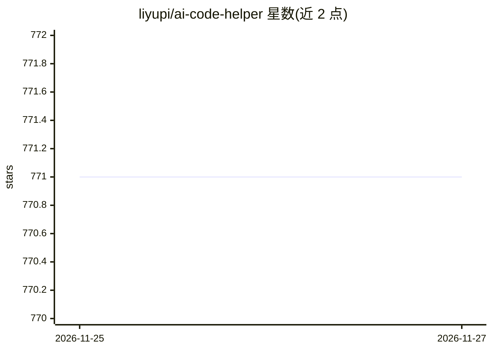

# liyupi/ai-code-helper

⭐ 771 · Vue · 推送 2026-11-23 · [GitHub](https://github.com/liyupi/ai-code-helper) · [官网](https://www.codefather.cn) · 个人维护 · 中文 README

**Java AI 全栈实战教程项目：编程学习与求职辅导助手**

前后端分离的 Spring Boot 3.5 + LangChain4j + Vue 3 项目，运行后提供编程学习导师、求职面试助手与代码答疑三类对话功能，后端通过 AI Service 编排通义千问对话模型、RAG 向量知识库、面试题爬虫工具、MCP 协议、Guardrail 输入护轨与 SSE 流式输出。项目定位为教程型实战项目，配套 B 站视频与图文教程，面向想通过完整项目掌握 LangChain4j 并积累 AI 全栈项目经历的 Java 开发者，仓库内后端与前端工程放在一起供对照阅读。

## 筛选速览

| 维度 | 判定 | 备注 |
|---|---|---|
| AI 角色 | `ai-knowledge` | 知识聚合/清单类 |
| 许可风险 | `none` | — |
| 部署形态 | `None` |  |
| 模型依赖 | local-ok | 支持本地模型 |
| 硬件要求 | — | 无带数字的原话,不猜 |
| 安装摩擦 | `medium` | 含编译或系统依赖之一 |
| 成熟度 | — | 结构信号不足 |

## 能力要点

- 覆盖 LangChain4j 核心范式：AI Service、对话记忆、结构化输出、RAG、Tool Calling、MCP、Guardrail、可观测性监听
- SSE 流式推送增量内容，Vue 3 界面配合 Markdown 渲染
- 内置 Guardrail 在请求送达大模型前检测敏感词与越权风险
- 后端核心类按模块划分（RagConfig/McpConfig/SafeInputGuardrail 等）供复用到业务项目

## 适用场景

- 跟着教程从零搭建一个完整 Java AI 应用，掌握 LangChain4j 用法
- 作为简历中的 AI 全栈项目经历素材
- 把仓库中的 RAG、MCP、护轨参考实现复用到自己的业务项目
- 日常用它获取学习路线建议、面试题检索与编程答疑

## 场景标签

`聊天机器人` `RAG` `网页抓取` `教程课程` · 领域:效率与自动化

## 证据(README 行号)

> L3: 基于 Spring Boot 3.5、Java 21、LangChain4j 与 Vue 3 构建的开源 AI 编程学习与求职辅导助手，由 程序员鱼皮 原创出品，通过一个结构精炼的全栈项目带你系统掌握 LangChain4j 核心开
> L12: > 大家好，我是 程序员鱼皮。如今 AI 应用开发已经成为程序员求职与进阶的必备技能。继使用 Spring AI 开源打造 AI 超级智能体项目（yu-ai-agent） 之后，我专门设计了这套小而精的实战项目，拒绝枯燥的纯理论灌

## 星数曲线

2026-11-25 771 → 2026-11-27 771（+0）

---
*卡片 v1 · prompt 1.4 · 生成 2026-11-24 · 置信度 mid · 依据 README sha `beca6669e4db` · [字段定义](../../DATASET.md)*
