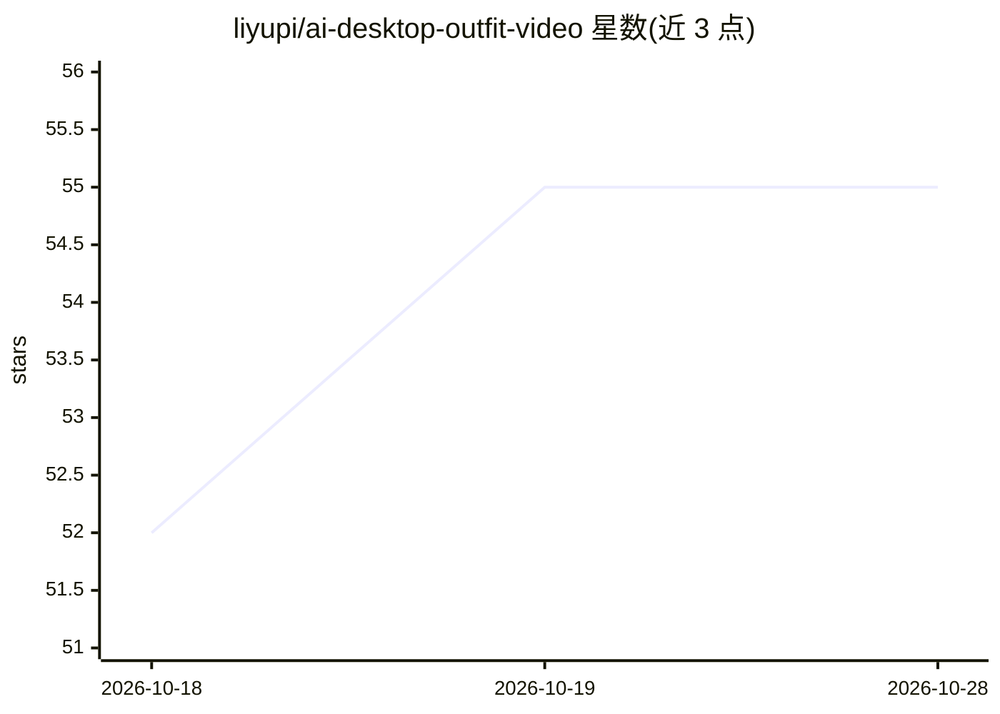

# liyupi/ai-desktop-outfit-video

⭐ 55 · Python · MIT · 推送 2026-09-20 · [GitHub](https://github.com/liyupi/ai-desktop-outfit-video) · 个人维护 · 中文 README

**AI 桌面换装视频的提示词模板与 Agent Skill 教程仓库**

把「桌面动态壁纸换装」类 AI 视频拆解为可复制的提示词模板：三步分步生成（参考图、10 秒验壳、10 秒验换装、30 秒成片），并总结固定机位、空镜过渡、字幕位置、节拍顺序四条核心规则。提供三种用法：直接抄提示词、用元提示词让任意 LLM 反向采访六个问题生成提示词、以及封装为 Cursor/Claude Code 可读取的 Agent Skill。附火山方舟 Seedance API 批量生成脚本，明确不提供任何模型或生成服务。

## 筛选速览

| 维度 | 判定 | 备注 |
|---|---|---|
| AI 角色 | `ai-knowledge` | 知识聚合/清单类 |
| 许可风险 | `permissive` | MIT |
| 部署形态 | `library` | 以包/库形式分发 |
| 模型依赖 | — | README 未给出锁定关系 |
| 硬件要求 | — | 无带数字的原话,不猜 |
| 安装摩擦 | `low` | 无编译、无系统依赖或容器化 |
| 成熟度 | — | 结构信号不足 |

## 能力要点

- 三步分步提示词模板，30 秒成片无需后期剪辑
- 元提示词让 LLM 反向采访六个问题后生成定制提示词
- 封装为 Cursor / Claude Code 可一键安装的 Agent Skill（SKILL.md）
- 火山方舟 Seedance API 批量生成脚本，含四个关键参数配置

## 适用场景

- 复刻桌面换装类 AI 视频而不自己摸索提示词
- 换人物/场景/造型时让 AI 采访我并生成定制提示词
- 通过 Cursor 或 Claude Code 一句话触发提示词生成流程
- 走 API 批量生成固定机位视频成片

## 场景标签

`提示工程` `视频生成` `教程课程` · 领域:Agent 开发

## 证据(README 行号)

> L3: 把最近很火的「AI 桌面换装视频」拆成了可复用的提示词模板和一个 Agent Skill。一条提示词直出 30 秒成片，不需要任何后期剪辑。
> L21: 打开 提示词.md，里面是三段可以直接复制的提示词，按顺序用：
> L108: - 本仓库只提供提示词模板和调用脚本，不提供任何模型或生成服务。

## 星数曲线

2026-10-18 52 → 2026-10-28 55（+3）

---
*卡片 v1 · prompt 1.4 · 生成 2026-10-24 · 置信度 mid · 依据 README sha `85b338e35f42` · [字段定义](../../DATASET.md)*
