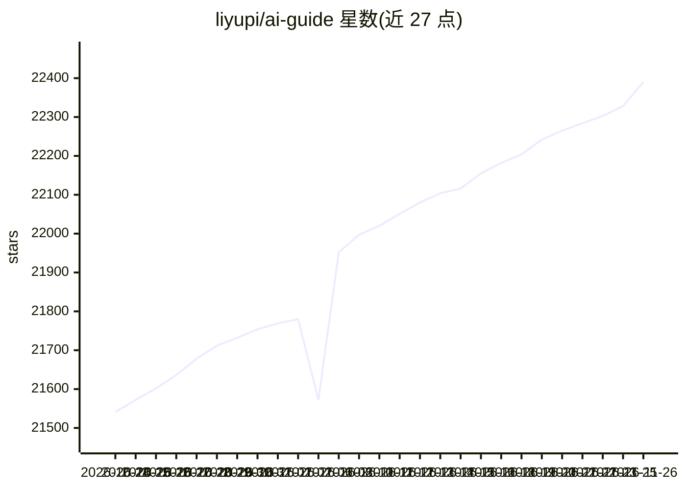

# liyupi/ai-guide

⭐ 22,390 · JavaScript · NOASSERTION · 推送 2026-11-25 · [GitHub](https://github.com/liyupi/ai-guide) · [官网](https://ai.codefather.cn) · 个人维护 · 中文 README

**免费 AI 知识库 + Vibe Coding 零基础教程，面向大众学习**

程序员鱼皮维护的免费开放 AI 知识共享平台，以 Markdown 教程文档 + VuePress 建站形式组织内容。主体是《Vibe Coding 零基础入门教程》，覆盖 AI 编程工具选择、项目实战、经验技巧、产品变现与编程进阶；另含 AI 知识库导航（DeepSeek 上手与本地部署、Cursor/Claude Code 技巧、Spring AI 框架、工具测评、办公/视频等应用场景）。提供在线阅读站与 B 站视频教程，支持中英繁翻译，接受社区共建。教程文档为 CC BY-NC-SA 协议，禁止商业使用。

## 筛选速览

| 维度 | 判定 | 备注 |
|---|---|---|
| AI 角色 | `ai-knowledge` | 知识聚合/清单类 |
| 许可风险 | `none` | NOASSERTION |
| 部署形态 | `None` |  |
| 模型依赖 | — | README 未给出锁定关系 |
| 硬件要求 | — | 无带数字的原话,不猜 |
| 安装摩擦 | `low` | 无编译、无系统依赖或容器化 |
| 成熟度 | — | 结构信号不足 |

## 动量与使用信号

- 维护:`active` — 距上次 push 20.2 天,年发版 0,6 位贡献者
- 涨星:近 1 天 **+67**(自 20261016 起算)
- 平台:— · 协议:MCP

## 能力要点

- 零基础 Vibe Coding 教程，含工具选择、项目实战、变现路径
- AI 知识库导航：DeepSeek 本地部署、Cursor/Claude Code 技巧、MCP 开发
- 提供在线阅读站与配套 B 站视频课程
- 教程文档 CC BY-NC-SA、建站代码 MIT 的双协议结构

## 适用场景

- 零基础学习用 AI 编程工具做出并上线自己的产品
- 查找 DeepSeek、Cursor 等工具的中文上手指南
- 了解 AI 工具测评与变现思路

## 场景标签

`教程课程` · 领域:学习与行业

## 证据(README 行号)

> L5:  完全免费开放的 AI 知识共享平台 | 减少信息差，让每个人都能享受技术红利
> L12: 这是一个 **完全免费开放** 的 AI 知识共享平台，汇总整合目前热门的 AI 工具相关信息，包括产品介绍、使用指南、工具测评、技巧分享、应用场景、AI 变现、行业资讯、教程资源等一系列内容。
> L114: ├── 🔥 Vibe Coding 零基础教程/     # 重磅教程，强烈推荐

## 星数曲线

2026-10-24 21,541 → 2026-11-26 22,390（+849）

---
*卡片 v1 · prompt 1.4 · 生成 2026-11-26 · 置信度 high · 依据 README sha `4bfbf49f2272` · [字段定义](../../DATASET.md)*
