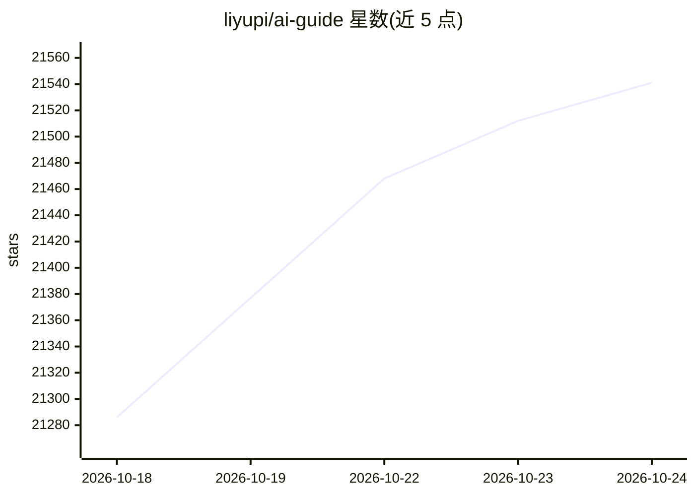

# liyupi/ai-guide

⭐ 21,572 · JavaScript · NOASSERTION · 推送 2026-10-22 · [GitHub](https://github.com/liyupi/ai-guide) · [官网](https://ai.codefather.cn) · 个人维护 · 中文 README

**面向零基础者的 Vibe Coding 教程与 AI 资源知识库**

以 VuePress 建站的免费 AI 知识共享平台，内容分为两部分：一是《Vibe Coding 零基础入门教程》，覆盖 AI 编程工具选用、项目实战、经验技巧、产品变现与进阶学习路线；二是 AI 知识库导航，收录 DeepSeek 上手与本地部署、Cursor/Claude Code 用法、Spring AI/LangChain 框架教程及工具测评文章。配套 B 站视频课程，提供中英双语版本，教程内容采用 CC BY-NC-SA 4.0、建站代码采用 MIT 的双协议，商业使用需授权。

## 筛选速览

| 维度 | 判定 | 备注 |
|---|---|---|
| AI 角色 | `ai-knowledge` | 知识聚合/清单类 |
| 许可风险 | `dual` | NOASSERTION |
| 部署形态 | `None` |  |
| 模型依赖 | — | README 未给出锁定关系 |
| 硬件要求 | — | 无带数字的原话,不猜 |
| 安装摩擦 | `low` | 无编译、无系统依赖或容器化 |
| 成熟度 | — | 结构信号不足 |

## 动量与使用信号

- 维护:`active` — 距上次 push 20.2 天,年发版 0,6 位贡献者
- 涨星:近 1 天 **+67**(自 20261016 起算)
- 平台:— · 协议:MCP

## 能力要点

- Vibe Coding 零基础教程：工具选型、项目实战、变现模式、学习路线
- AI 知识库导航：含 DeepSeek 本地部署、Cursor/Claude Code 技巧、MCP 开发
- 提供英文与繁体中文翻译版本及 B 站配套视频课程
- 教程内容 CC BY-NC-SA 4.0 + 建站代码 MIT 的双协议

## 适用场景

- 零基础学习用 AI 编程工具从 0 到 1 做出产品
- 查找 DeepSeek、Cursor 等工具的中文上手教程
- 了解 AI 产品的变现路径与运营方法

## 场景标签

`教程课程` `精选清单` · 领域:学习与行业

## 证据(README 行号)

> L12: 这是一个 **完全免费开放** 的 AI 知识共享平台，汇总整合目前热门的 AI 工具相关信息，包括产品介绍、使用指南、工具测评、技巧分享、应用场景、AI 变现、行业资讯、教程资源等一系列内容。
> L20: ## 🔥 鱼皮的 Vibe Coding 零基础入门教程
> L66: ## AI 知识库导航

## 星数曲线

2026-10-18 21,286 → 2026-10-24 21,541（+255）

---
*卡片 v1 · prompt 1.4 · 生成 2026-10-18 · 置信度 high · 依据 README sha `760fcdbf783e` · [字段定义](../../DATASET.md)*
