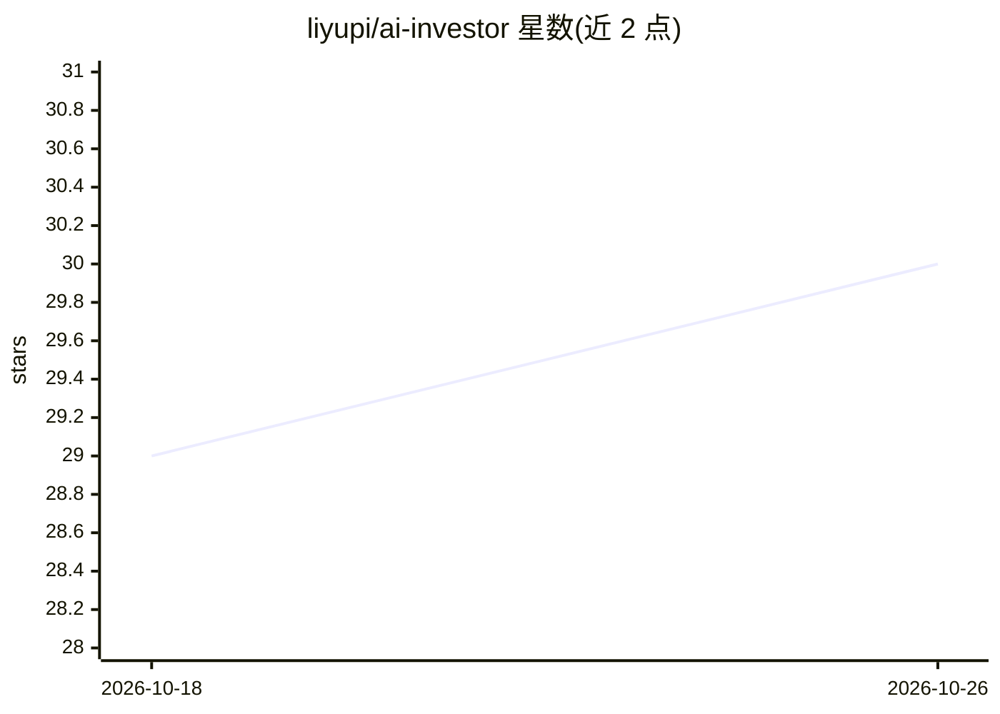

# liyupi/ai-investor

⭐ 30 · TypeScript · 推送 2026-06-25 · [GitHub](https://github.com/liyupi/ai-investor) · 个人维护 · 中文 README

**AI 副业想法验证工具：联网搜索后给出投资级点评**

面向想做副业的用户：输入副业想法，AI 投资人角色联网搜索竞品、市场规模与融资案例，输出 S/A/B/C 四级评价，以及赛道分析、核心风险、差异化建议与变现路径点评。支持多轮对话与追问，基于 EdgeOne Makers Agent Runtime 后端与 OpenAI Agents SDK 构建，默认模型 deepseek-v4-flash，通过 AI Gateway 接入，可用 edgeone makers deploy 一键部署到 EdgeOne Pages。

## 筛选速览

| 维度 | 判定 | 备注 |
|---|---|---|
| AI 角色 | `ai-native` | 本体是模型或模型工具 |
| 许可风险 | `none` | — |
| 部署形态 | `library` | 以包/库形式分发 |
| 模型依赖 | — | README 未给出锁定关系 |
| 硬件要求 | — | 无带数字的原话,不猜 |
| 安装摩擦 | `low` | 无编译、无系统依赖或容器化 |
| 成熟度 | — | 结构信号不足 |

## 能力要点

- 联网搜索竞品、市场规模、融资案例后给出投资判断
- S/A/B/C 四级评价体系与犀利点评（赛道/风险/差异化/变现）
- 多轮对话，基于 context.store 持久化对话历史
- OpenAI Agents SDK + EdgeOne Makers Agent Runtime，一键部署

## 适用场景

- 提交副业想法，获得基于联网搜索的投资级点评
- 多轮迭代方案并追问改进建议
- 快速了解副业赛道的竞品与变现路径

## 场景标签

`聊天机器人` · 领域:对话与助手

## 证据(README 行号)

> L3: 一个 AI 副业想法验证工具。输入你的副业想法，AI 投资人会联网搜索竞品和市场数据，给出犀利的投资判断和建议。
> L20: |AI 框架|OpenAI Agents SDK|

## 星数曲线

2026-10-18 29 → 2026-10-26 30（+1）

---
*卡片 v1 · prompt 1.4 · 生成 2026-10-26 · 置信度 high · 依据 README sha `a40688add5e5` · [字段定义](../../DATASET.md)*
