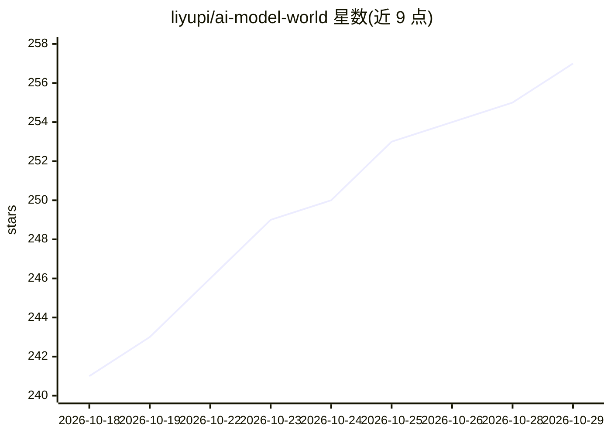

# liyupi/ai-model-world

⭐ 257 · TypeScript · MIT · 推送 2026-10-28 · [GitHub](https://github.com/liyupi/ai-model-world) · [官网](https://bilibili.com/toy/ai-model-world) · 个人维护 · 中文 README

**把 556 个大模型拟人化为像素小人的可视化站点**

基于 Next.js 静态导出的零后端可视化站点：将 556 个大模型以像素小人形式放入按厂商、地区组织的广场，提供今日格局领奖台、按类型筛选、模型详情页、发布时间线与多维排行榜（跨赛制分数不混算）。数据取自 models.dev、Epoch AI、LiveBench、Hugging Face 等，每小时自动同步，所有文案由真实数据套模板生成，不调用 LLM。支持按模型名、厂商、能力搜索。本地开发需 npm，数据管线离线确定性、无需 API 密钥。

## 筛选速览

| 维度 | 判定 | 备注 |
|---|---|---|
| AI 角色 | `ai-knowledge` | 知识聚合/清单类 |
| 许可风险 | `permissive` | MIT |
| 部署形态 | `library` | 以包/库形式分发 |
| 模型依赖 | — | README 未给出锁定关系 |
| 硬件要求 | — | 无带数字的原话,不猜 |
| 安装摩擦 | `low` | 无编译、无系统依赖或容器化 |
| 成熟度 | — | 结构信号不足 |

## 能力要点

- 556 个模型拟人化为像素角色，按国内外厂商分区组织
- 数据每小时自动同步，文案由数据套模板生成、不调用 LLM
- 多维排行榜跨赛制分数不混算，每榜标注数据来源与参赛模型数
- 数据与素材管线离线确定性，217 项纯函数自检

## 适用场景

- 查看当前各类能力（智力/编程/价格等）领先的模型
- 按厂商浏览国内外大模型格局与最新发布
- 检索特定能力（如多模态）的全部模型
- 回顾三年多大模型发布时间线

## 场景标签

`模型评测` · 领域:评测与运维

## 证据(README 行号)

> L3: AI 模型多到记不住，新闻里天天蹦出新名字，可你很难说清此刻到底谁最强、谁最便宜、谁刚出生。
> L63: |用途|来源|许可|

## 星数曲线

2026-10-18 241 → 2026-10-29 257（+16）

---
*卡片 v1 · prompt 1.4 · 生成 2026-10-22 · 置信度 high · 依据 README sha `8253aeb417c9` · [字段定义](../../DATASET.md)*
