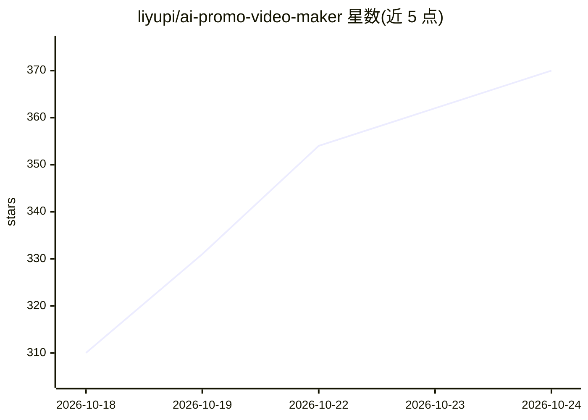

# liyupi/ai-promo-video-maker

⭐ 370 · Python · MIT · 推送 2026-10-09 · [GitHub](https://github.com/liyupi/ai-promo-video-maker) · 个人维护 · 中文 README

**让 AI 编程工具自动制作 4K 产品宣传片的规范与工程模板**

以一份 AI 可执行的工作规范（AGENTS.md）加 Remotion 视频工程模板和辅助脚本组成，供 Cursor、Claude Code、Codex 等 AI 编程工具照做：用户一句话提出需求，AI 先调研产品、分两轮问询、生成 3-4 个风格样帧供挑选，随后自动截图（4K 网页截图需登录时请用户登录）、配乐、生成 ElevenLabs 旁白（可选）、按节拍剪辑并逐句转写校验，渲染前后设检查闸门，交付 4K 视频与网页播放版。可克隆仓库使用，也可 npx skills add 安装为 Agent Skill。限制：需 Node.js 18+/Python 3.9+/ffmpeg，Remotion 对 3 人以上团队需商业授权，免费 ElevenLabs 内容不可商用。

## 筛选速览

| 维度 | 判定 | 备注 |
|---|---|---|
| AI 角色 | `ai-native` | 本体是模型或模型工具 |
| 许可风险 | `permissive` | MIT |
| 部署形态 | `library` | 以包/库形式分发 |
| 模型依赖 | — | README 未给出锁定关系 |
| 硬件要求 | — | 无带数字的原话,不猜 |
| 安装摩擦 | `medium` | 含编译或系统依赖之一 |
| 成熟度 | — | 结构信号不足 |

## 能力要点

- 10 阶段自动化流程，仅需求确认与试听需用户参与
- 4K 网页截图脚本与旁白逐句转写校验机制
- 渲染前后多道检查闸门（分辨率、响度、场景截图审查）
- 60+ 条踩坑记录与案例复盘作为 AI 先验经验

## 适用场景

- 给 App、网站、开源项目做商业宣传片
- 在自己产品仓库里一句话调用 Skill 生成介绍视频
- 单独使用模板中的混音、节拍分析、4K 截图脚本

## 场景标签

`视频生成` `语音合成` · 领域:内容生成

## 证据(README 行号)

> L3: **一句话告诉 AI 你要宣传什么，它会自己调研、提问、截图、配乐、配音、剪辑和校验，最后交给你一支 4K 商业宣传片。**
> L17: 这个项目把整套制作流程写成了一份 AI 能读懂、能照着执行的工作规范（`AGENTS.md`），并配上一个 Remotion 视频工程模板和十几个辅助脚本。你可以把仓库克隆到本地，用 Cursor、Claude Code、Code
> L104: 编程导航是一个编程学习社区。这支片子用代码绘制了一座浅色的等距 3D 城市，把学习路线、项目教程、面试求职串成一条通往 Offer 的道路。片子以三个学编程的痛点开场，第 4.4 秒音乐爆发、品牌登场，随后用 10 张登录后截取

## 星数曲线

2026-10-18 310 → 2026-10-24 370（+60）

---
*卡片 v1 · prompt 1.4 · 生成 2026-10-21 · 置信度 high · 依据 README sha `6687136c05e3` · [字段定义](../../DATASET.md)*
