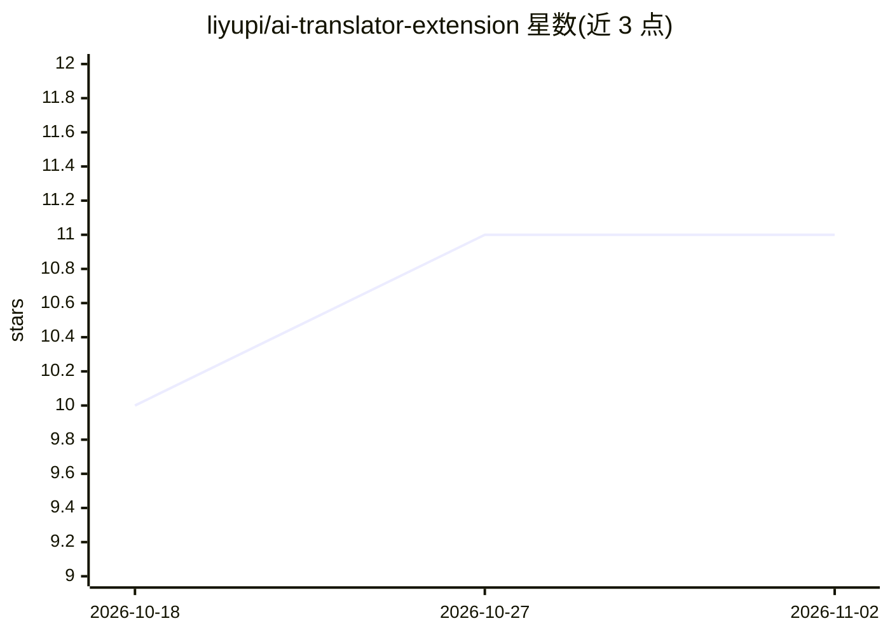

# liyupi/ai-translator-extension

⭐ 11 · JavaScript · 推送 2026-06-29 · [GitHub](https://github.com/liyupi/ai-translator-extension) · [官网](https://liyupi.github.io/ai-translator-extension/) · 个人维护 · 中文 README

**AI 网页翻译 Chrome 扩展：全页/划词翻译与网页总结**

基于 Chrome Extension Manifest V3 与 Vanilla JavaScript 的浏览器翻译插件，兼容 OpenAI 协议，用户自行配置 API Key、Base URL 与模型名称（如 DeepSeek）后使用。功能包括全页面翻译（中英互译）、划词翻译、右键菜单翻译与 AI 网页总结。以开发者模式加载未打包源码方式安装，为鱼皮 AI 编程零基础教程的 Demo 项目。

## 筛选速览

| 维度 | 判定 | 备注 |
|---|---|---|
| AI 角色 | `ai-native` | 本体是模型或模型工具 |
| 许可风险 | `none` | — |
| 部署形态 | `None` |  |
| 模型依赖 | locked-api |  |
| 硬件要求 | — | 无带数字的原话,不猜 |
| 安装摩擦 | `low` | 无编译、无系统依赖或容器化 |
| 成熟度 | — | 结构信号不足 |

## 能力要点

- 全页面翻译、划词翻译、右键菜单翻译与网页总结
- 兼容 OpenAI 协议，支持 DeepSeek、OpenAI 等自定义 API 配置
- Manifest V3 + Vanilla JavaScript，无框架依赖
- 提供测试连接与保存设置的配置界面

## 适用场景

- 浏览外文网页时一键翻译整页或选中文字
- 让 AI 总结网页内容提取关键信息
- 使用自己已有的 OpenAI 兼容 API（如 DeepSeek）做翻译

## 场景标签

 · 领域:浏览器工具/翻译

## 证据(README 行号)

> L3: AI 驱动的 Chrome 浏览器翻译插件，支持全页面翻译、划词翻译和网页总结。兼容 OpenAI 协议，可自定义 API 配置。
> L9: - **网页总结** - AI 自动总结网页内容，提取关键信息
> L42: - OpenAI 兼容 API 协议

## 星数曲线

2026-10-18 10 → 2026-11-02 11（+1）

---
*卡片 v1 · prompt 1.4 · 生成 2026-11-02 · 置信度 high · 依据 README sha `2065fb7c7dcc` · [字段定义](../../DATASET.md)*
