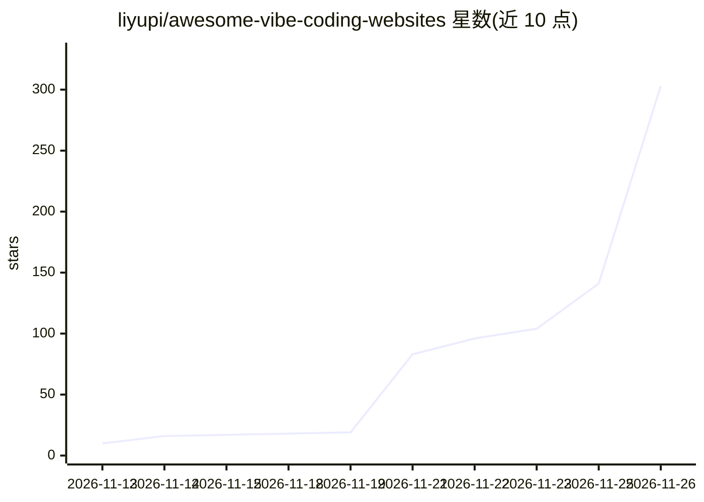

# liyupi/awesome-vibe-coding-websites

⭐ 303 · NOASSERTION · 推送 2026-11-25 · [GitHub](https://github.com/liyupi/awesome-vibe-coding-websites) · [官网](https://vibefather.ai) · 个人维护 · 中文 README

**AI 生成网站模板清单：274 套模板附原始提示词**

面向开发者、设计师与独立开发者的 vibe coding 网站模板策展清单：收录 274 个原创模板与 564 个在线演示，由 9 个 AI 模型（Claude、GPT、Gemini、Grok、Kimi、GLM、DeepSeek）生成，每个模板附带生成它的原始提示词与 DESIGN.md，可粘贴到 Claude Code、Cursor 或 Codex 等 AI 编码工具复现。按落地页、SaaS、作品集、电商、仪表盘等类别组织，并提供同一提示词在两个模型下的对照演示。站点采用 React、Tailwind CSS、Three.js 等前端栈，许可为 CC BY-NC 4.0。

## 筛选速览

| 维度 | 判定 | 备注 |
|---|---|---|
| AI 角色 | `ai-knowledge` | 知识聚合/清单类 |
| 许可风险 | `none` | NOASSERTION |
| 部署形态 | `None` |  |
| 模型依赖 | — | README 未给出锁定关系 |
| 硬件要求 | — | 无带数字的原话,不猜 |
| 安装摩擦 | `low` | 无编译、无系统依赖或容器化 |
| 成熟度 | — | 结构信号不足 |

## 能力要点

- 274 个模板与 564 个在线演示，附原始提示词与 DESIGN.md
- 覆盖 9 个 AI 模型的生成结果，可按模型浏览对照
- 按落地页/SaaS/作品集/电商等类别组织
- 提供同一提示词在两个模型下的设计对照（12 组）

## 适用场景

- 找一个经过验证的提示词来快速生成落地页或 SaaS 站点
- 对比不同 AI 模型在相同前端提示词下的产出差异
- 浏览各类网站模板的在线演示寻找建站灵感

## 场景标签

`精选清单` · 领域:学习与行业

## 证据(README 行号)

> L9:  274 original website templates and 564 live demos built by AI coding agents — each with the exact prompt and a DESI
> L20: **Awesome Vibe Coding Websites** is a free, open library of 274 original vibe coding website templates and 564 live

## 星数曲线

2026-11-13 10 → 2026-11-26 303（+293）

---
*卡片 v1 · prompt 1.4 · 生成 2026-11-18 · 置信度 high · 依据 README sha `2e4f6d3ae1e7` · [字段定义](../../DATASET.md)*
