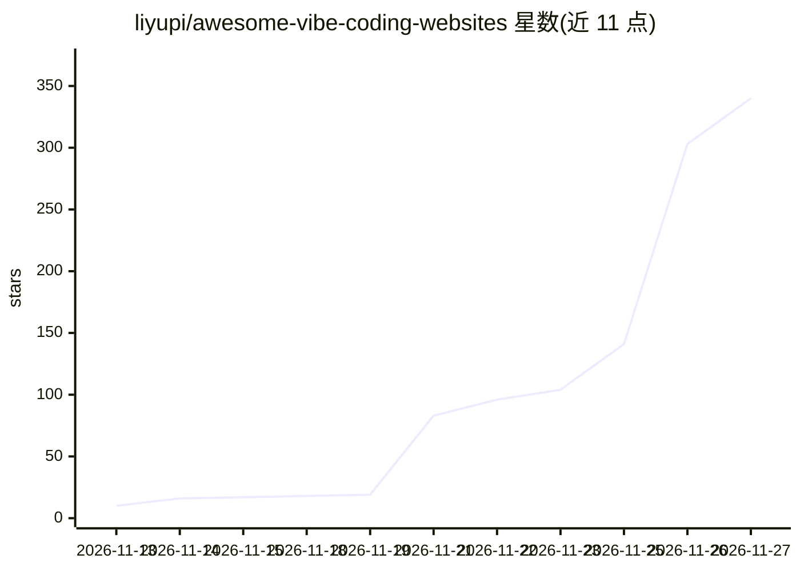

# liyupi/awesome-vibe-coding-websites

⭐ 340 · NOASSERTION · 推送 2026-11-26 · [GitHub](https://github.com/liyupi/awesome-vibe-coding-websites) · [官网](https://vibefather.ai) · 个人维护 · 中文 README

**给网站开发者用的 AI 生成网站模板与提示词清单**

收录 324 个由 13 个 AI 模型生成的原创网站模板和 680 个在线演示，每个条目附构建它的完整提示词与 DESIGN.md 文件，用户可替换变量后粘贴到 AI 编码工具中生成同类网站。按落地页、SaaS、作品集、电商、仪表盘等类别组织，并提供同一提示词跨模型对比的章节；模板基于 React、Tailwind CSS、Three.js 等前端栈。许可证为 CC BY-NC 4.0，浏览入口为 VibeFather 平台。

## 筛选速览

| 维度 | 判定 | 备注 |
|---|---|---|
| AI 角色 | `ai-knowledge` | 知识聚合/清单类 |
| 许可风险 | `none` | NOASSERTION |
| 部署形态 | `None` |  |
| 模型依赖 | — | README 未给出锁定关系 |
| 硬件要求 | — | 无带数字的原话,不猜 |
| 安装摩擦 | `low` | 无编译、无系统依赖或容器化 |
| 成熟度 | — | 结构信号不足 |

## 能力要点

- 324 个模板均附精确提示词与 DESIGN.md
- 680 个在线演示，按 10 个网站类别组织
- 同提示词由不同模型构建的并排对比（24 组）
- 模板使用 React/Tailwind/Motion/Three.js/GSAP 等真实前端栈

## 适用场景

- 找一个已验证可用的提示词来启动落地页/SaaS 站点项目
- 对比不同 AI 模型处理同一前端提示词的输出差异
- 为作品集、商店、仪表盘类网站挑选参考模板

## 场景标签

`精选清单` `代码生成` · 领域:编码与开发

## 证据(README 行号)

> L9:  324 original website templates and 680 live demos built by AI coding agents — each with the exact prompt and a DESI
> L20: **Awesome Vibe Coding Websites** is a free, open library of 324 original vibe coding website templates and 680 live

## 星数曲线

2026-11-13 10 → 2026-11-27 340（+330）

---
*卡片 v1 · prompt 1.4 · 生成 2026-11-27 · 置信度 high · 依据 README sha `ed0c4f268186` · [字段定义](../../DATASET.md)*
