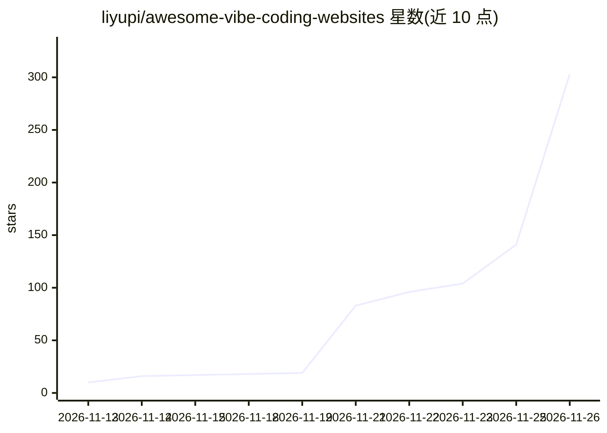

# liyupi/awesome-vibe-coding-websites

⭐ 303 · NOASSERTION · 推送 2026-11-25 · [GitHub](https://github.com/liyupi/awesome-vibe-coding-websites) · [官网](https://vibefather.ai) · 个人维护 · 中文 README

**AI 生成网站模板库：324 套模板附原始提示词与设计文档**

收集 324 个由 13 个 AI 模型生成的原创网站模板与 678 个在线演示，每条附完整提示词与 DESIGN.md。用户替换变量后将提示词粘贴到 Claude Code、Cursor、Codex 等 AI 编码工具复现同类网站。按落地页、SaaS、作品集、电商、仪表盘等 10 个类别组织，并提供同提示词跨模型对比页面。前端使用 React、Tailwind CSS、Three.js、GSAP 等真实技术栈。许可为 CC BY-NC 4.0，仅限非商业用途。

## 筛选速览

| 维度 | 判定 | 备注 |
|---|---|---|
| AI 角色 | `ai-knowledge` | 知识聚合/清单类 |
| 许可风险 | `none` | NOASSERTION |
| 部署形态 | `None` |  |
| 模型依赖 | — | README 未给出锁定关系 |
| 硬件要求 | — | 无带数字的原话,不猜 |
| 安装摩擦 | `low` | 无编译、无系统依赖或容器化 |
| 成熟度 | — | 结构信号不足 |

## 能力要点

- 324 个模板均附生成所用确切提示词与 DESIGN.md
- 按 10 个类别组织，支持按站点类型、风格或 AI 模型浏览
- 提供同一提示词由不同模型生成的成对对比演示
- 演示站点在 VibeFather 平台在线预览

## 适用场景

- 想用 AI 编码工具快速搭一个落地页或 SaaS 站点，找已验证的提示词起步
- 对比不同 AI 模型在同一前端提示词下的产出差异
- 为作品集、店铺或活动页挑选可复用的前端模板与设计文档

## 场景标签

`提示工程` `精选清单` `代码生成` · 领域:Agent 开发

## 证据(README 行号)

> L20: **Awesome Vibe Coding Websites** is a free, open library of 324 original vibe coding website templates and 678 live
> L22: It's made for developers, designers, indie hackers and anyone who builds websites with AI. Browse by site type, sty

## 星数曲线

2026-11-13 10 → 2026-11-26 303（+293）

---
*卡片 v1 · prompt 1.4 · 生成 2026-11-26 · 置信度 high · 依据 README sha `732f88731fa3` · [字段定义](../../DATASET.md)*
