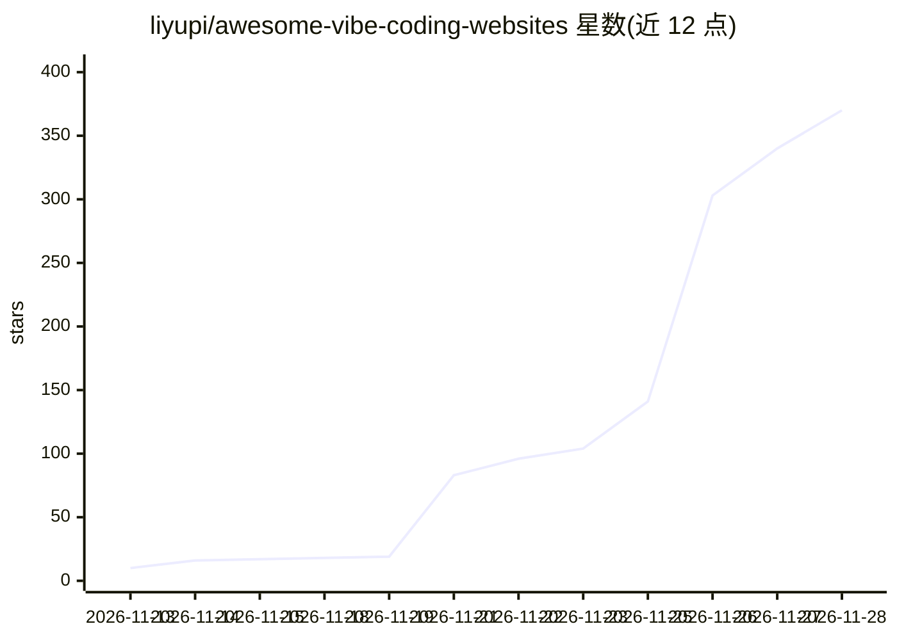

# liyupi/awesome-vibe-coding-websites

⭐ 370 · NOASSERTION · 推送 2026-11-27 · [GitHub](https://github.com/liyupi/awesome-vibe-coding-websites) · [官网](https://vibefather.ai) · 组织维护

**AI 生成网站模板库：340+ 模板带完整提示词与设计文档**

收录 343 个由 13 个 AI 模型生成的原创网站模板与 717 个在线演示，每个条目附构建该演示的确切提示词与 DESIGN.md。用户替换模板中的变量后，将提示词粘贴到 Claude Code、Cursor 或 Codex 等 AI 编码工具中生成同类网站。覆盖落地页、SaaS 站点、作品集、商店、仪表盘、3D 场景与浏览器游戏等 10 个分类，模板使用 React、Tailwind CSS、Three.js、GSAP 等前端栈，演示在桌面与移动端检查后上线，许可为 CC BY-NC 4.0。

## 筛选速览

| 维度 | 判定 | 备注 |
|---|---|---|
| AI 角色 | `ai-knowledge` | 知识聚合/清单类 |
| 许可风险 | `none` | NOASSERTION |
| 部署形态 | `None` |  |
| 模型依赖 | — | README 未给出锁定关系 |
| 硬件要求 | — | 无带数字的原话,不猜 |
| 安装摩擦 | `low` | 无编译、无系统依赖或容器化 |
| 成熟度 | — | 结构信号不足 |

## 能力要点

- 343 个模板附确切提示词与 DESIGN.md
- 717 个在线演示可在 VibeFather 上预览
- 同一提示词由两个模型生成的对比展示（24 组）
- 按站点类型、风格或 AI 模型浏览

## 适用场景

- 从已测试过的提示词起步生成落地页或 SaaS 站点
- 并排比较不同 AI 模型处理同一前端提示词的效果
- 为作品集、商店、仪表盘寻找网站模板灵感

## 场景标签

`提示工程` `精选清单` · 领域:Agent 开发

## 证据(README 行号)

> L9:  343 original website templates and 717 live demos built by AI coding agents — each with the exact prompt and a DESI
> L20: **Awesome Vibe Coding Websites** is a free, open library of 343 original vibe coding website templates and 717 live
> L22: It's made for developers, designers, indie hackers and anyone who builds websites with AI. Browse by site type, sty

## 星数曲线

2026-11-13 10 → 2026-11-28 370（+360）

---
*卡片 v1 · prompt 1.4 · 生成 2026-11-28 · 置信度 high · 依据 README sha `6dd5268d613b` · [字段定义](../../DATASET.md)*
