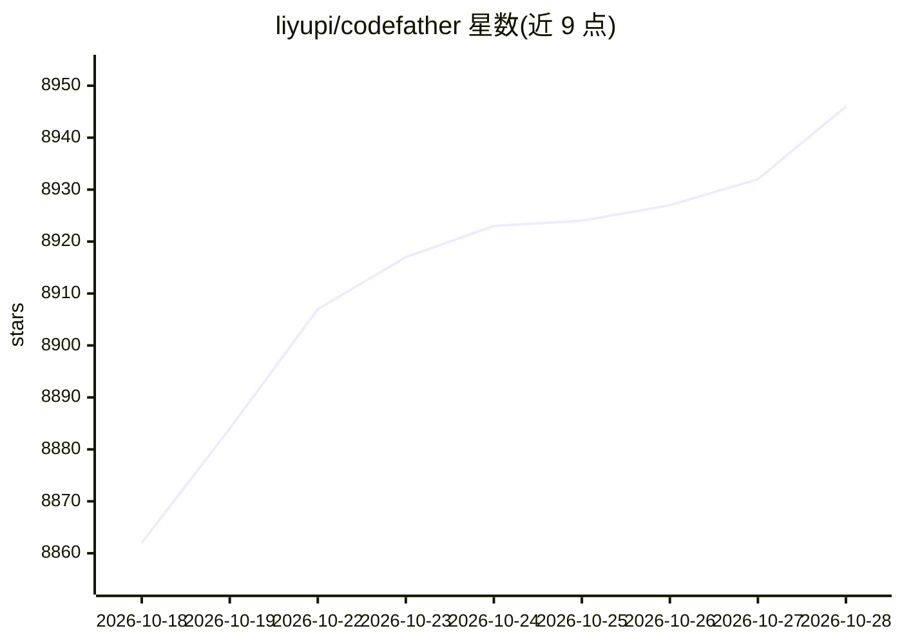

# liyupi/codefather

⭐ 8,946 · TypeScript · 推送 2026-07-11 · [GitHub](https://github.com/liyupi/codefather) · [官网](https://codefather.cn) · 个人维护 · 中文 README

**面向编程学习者的知识百科与学习路线站（codefather.cn）**

程序员鱼皮维护的编程学习知识站点，内容涵盖 Java、前端、C++、Python、SQL、算法、Git、Linux 等多门学习路线，以及编程干货、原创项目实战教程（从学习到简历与面试题）、Bug 修复手册、编程词典（覆盖 30 个技术方向的术语）等栏目。另收录作者个人学习求职经历和其创建的付费学习社区『编程导航』及旗下产品服务介绍。README 为站点内容导航，未提供安装或运行方式。

## 筛选速览

| 维度 | 判定 | 备注 |
|---|---|---|
| AI 角色 | `ai-knowledge` | 知识聚合/清单类 |
| 许可风险 | `none` | — |
| 部署形态 | `None` |  |
| 模型依赖 | — | README 未给出锁定关系 |
| 硬件要求 | — | 无带数字的原话,不猜 |
| 安装摩擦 | `low` | 无编译、无系统依赖或容器化 |
| 成熟度 | — | 结构信号不足 |

## 能力要点

- 多语言与计算机基础方向的编程学习路线
- 原创项目实战教程系列，含简历写法与面试题解
- 覆盖 30 个技术方向的编程词典
- Bug 修复流程与案例手册

## 适用场景

- 零基础按路线图自学编程
- 查找项目实战教程与面试求职资料
- 查阅技术术语与常见 Bug 解决方案

## 场景标签

`教程课程` · 领域:学习与行业

## 证据(README 行号)

> L5: > 贴心的编程学习路线，全面的编程知识百科
> L24: ## 编程学习路线
> L26: 包含 Java、前端、C++、Python、SQL、计算机基础、数据结构和算法、Git & GitHub、Linux、设计模式等多个精心编写的学习路线，帮助程序员快速入门。

## 星数曲线

2026-10-18 8,862 → 2026-10-28 8,946（+84）

---
*卡片 v1 · prompt 1.4 · 生成 2026-10-20 · 置信度 high · 依据 README sha `020ca0fec445` · [字段定义](../../DATASET.md)*
