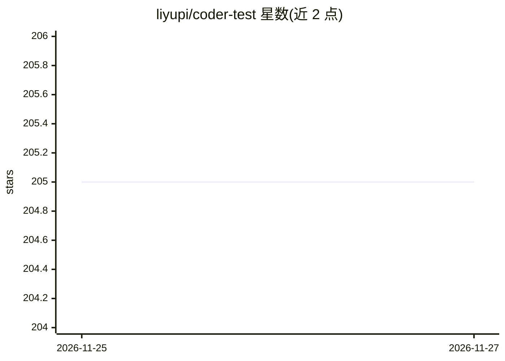

# liyupi/coder-test

⭐ 205 · Vue · 推送 2026-11-23 · [GitHub](https://github.com/liyupi/coder-test) · [官网](https://www.codefather.cn/course/1965699176489484289) · 个人维护 · 中文 README

**程序员的 AI 技术闯关练兵场：生成关卡、评估薪资与架构报告**

前后端分离的全栈项目，后端 Spring Boot 3 + Java 21 + LangChain4j，前端 Vue 3。平台调用通义千问大模型按技术方向与模拟薪资档位生成企业业务背景的技术挑战关卡，用户以拖拽方式组合技术方案作答，AI 评委会调整模拟薪资并生成复盘报告，含 Mermaid 架构图/流程图渲染、面试题推荐与历史成长曲线。安装需自备 JDK 21、Maven、MySQL 8、Redis 6、Node.js，配置 DashScope API Key 后以 Maven 与 npm 分别启动前后端。项目源自编程导航直播课程，同时作为 AI 应用开发教学内容。

## 筛选速览

| 维度 | 判定 | 备注 |
|---|---|---|
| AI 角色 | `ai-native` | 本体是模型或模型工具 |
| 许可风险 | `none` | — |
| 部署形态 | `library` | 以包/库形式分发 |
| 模型依赖 | — | README 未给出锁定关系 |
| 硬件要求 | — | 无带数字的原话,不猜 |
| 安装摩擦 | `medium` | 含编译或系统依赖之一 |
| 成熟度 | — | 结构信号不足 |

## 能力要点

- AI 按薪资档位与技术方向生成企业业务背景的挑战关卡
- 结构化输出 + Tool Calling 生成复盘报告并渲染 Mermaid 架构图
- 拖拽式多组件组合答题与动态薪资评估
- 闯关记录持久化与薪资成长曲线可视化

## 适用场景

- 检验自己在前后端、测试、运维、算法方向的技术选型能力
- 求职前模拟企业业务场景答题并获取学习建议
- 作为 Java AI 应用开发（LangChain4j）的学习实战项目

## 场景标签

`教程课程` `AI 助手` `模型评测` · 领域:对话与助手

## 证据(README 行号)

> L11: **AI 程序员技术练兵场（`coder-test`）** 是一套以 AI 应用开发实战与全栈工程能力为核心的开源项目，由 程序员鱼皮 在 编程导航 全程直播从零到一带领开发。项目基于 Spring Boot 3、Java 21、
> L41: 提交答案后，后端通过结构化输出与工具调用协同生成一份详尽的闯关复盘报告，不仅包含综合评分、薪资变动与简历投递建议，还会自动输出技术原理解析、基于 Mermaid 渲染的系统架构图与业务流程图，以及个性化的学习路线建议和对应面试题推
> L74: |AI 应用与大模型能力|LangChain4j、LangChain4j Community DashScope（阿里云通义千问集成）、提示词工程、结构化输出、对话记忆与 Tool Calling 工具调用|

## 星数曲线

2026-11-25 205 → 2026-11-27 205（+0）

---
*卡片 v1 · prompt 1.4 · 生成 2026-11-24 · 置信度 high · 依据 README sha `82b9744e1211` · [字段定义](../../DATASET.md)*
