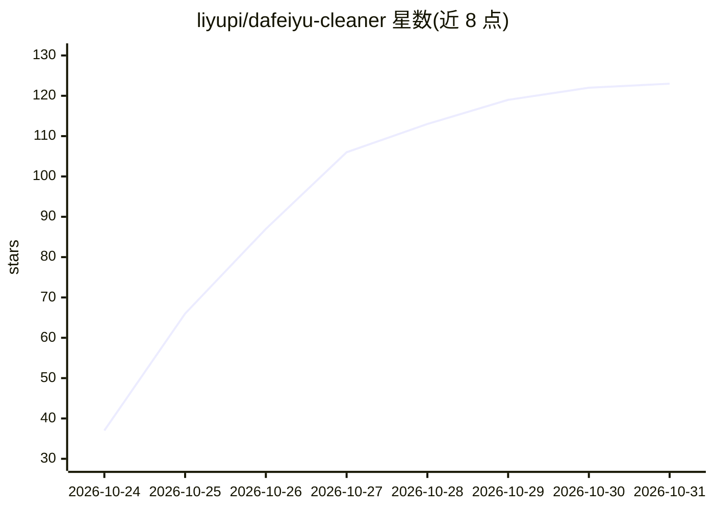

# liyupi/dafeiyu-cleaner

⭐ 123 · JavaScript · NOASSERTION · 推送 2026-10-25 · [GitHub](https://github.com/liyupi/dafeiyu-cleaner) · [官网](https://www.bilibili.com/video/BV1Ywn46EEyF) · 个人维护 · 中文 README

**识别并本地隐藏 B 站评论区 AI 机器人账号的浏览器插件**

面向 B 站用户的 Chrome/Edge/Firefox 浏览器插件，用于识别和清理由 DeepSeek 等大模型、AI Agent 驱动的机器人账号（“大肥鱼”）。默认完全离线，按昵称、签名、等级、头像、正文等维度对账号打分，判为机器人的评论仅在本浏览器内隐藏、折叠，不删评、不举报、不读 Cookie；可选填入自己的 DeepSeek API Key 对拿不准的账号二次精判，结果本机缓存 7 天。另提供 UP 主空间主页鉴定报告、名单导入导出与快捷键清场。纯原生 JavaScript，无构建步骤。

## 筛选速览

| 维度 | 判定 | 备注 |
|---|---|---|
| AI 角色 | `ai-enhanced` | 去掉 AI 部分产品仍成立 |
| 许可风险 | `none` | NOASSERTION |
| 部署形态 | `None` |  |
| 模型依赖 | — | README 未给出锁定关系 |
| 硬件要求 | — | 无带数字的原话,不猜 |
| 安装摩擦 | `low` | 无编译、无系统依赖或容器化 |
| 成熟度 | — | 结构信号不足 |

## 能力要点

- 离线多维度打分（0–99），60 分以上判为大肥鱼，严格度可调
- 可选 DeepSeek API 精判，最终分数=离线 45%+DeepSeek 55%，结果缓存 7 天
- 所有“赶走/折叠”仅本地隐藏，不调用 B 站写接口、不读 Cookie
- 支持 Chrome/Edge/Firefox（140+），功能一致

## 适用场景

- 刷 B 站评论区时自动识别并折叠 AI 机器人账号的评论
- 鉴定某个 UP 主是否为 AI 驱动的机器人账号
- 一键清场并查看本轮清理战报，误判可放回

## 场景标签

 · 领域:浏览器插件/AI 内容检测

## 证据(README 行号)

> L16: **大肥鱼消除计划（dafeiyu-cleaner）**是一个免费开源的 Chrome / Edge / Firefox 浏览器插件，专门识别 B 站（Bilibili）上由 DeepSeek 等大模型、AI Agent 驱动的机
> L144: 默认完全离线，不联网。每个账号按下面这些维度打分（0–99），默认 60 分以上判为大肥鱼，35 分以上算可疑，严格度可以在设置里调。

## 星数曲线

2026-10-24 37 → 2026-10-31 123（+86）

---
*卡片 v1 · prompt 1.4 · 生成 2026-10-24 · 置信度 high · 依据 README sha `2f5b97763765` · [字段定义](../../DATASET.md)*
