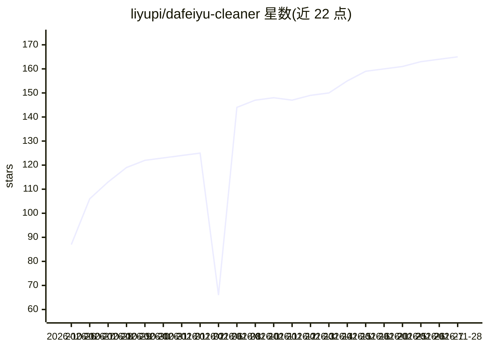

# liyupi/dafeiyu-cleaner

⭐ 165 · JavaScript · NOASSERTION · 推送 2026-10-25 · [GitHub](https://github.com/liyupi/dafeiyu-cleaner) · [官网](https://www.bilibili.com/video/BV1Ywn46EEyF) · 个人维护 · 中文 README

**识别并清理 B 站评论区 DeepSeek AI 机器人账号的浏览器插件**

免费开源的 Chrome / Edge / Firefox 浏览器插件，面向 B 站用户识别由 DeepSeek 等大模型驱动的机器人账号。默认离线规则打分：按昵称、签名、等级、头像颜色占比、正文特征等维度评 0–99 分；可选填入用户自己的 DeepSeek API Key 对拿不准的账号做二次判定，离线与 API 分数按 45%/55% 合成。所有处理仅本地隐藏，不调用 B 站写接口、不读 Cookie；安装包在 Releases 下载后手动加载。

## 筛选速览

| 维度 | 判定 | 备注 |
|---|---|---|
| AI 角色 | `ai-native` | 本体是模型或模型工具 |
| 许可风险 | `none` | NOASSERTION |
| 部署形态 | `None` |  |
| 模型依赖 | — | README 未给出锁定关系 |
| 硬件要求 | — | 无带数字的原话,不猜 |
| 安装摩擦 | `low` | 无编译、无系统依赖或容器化 |
| 成熟度 | — | 结构信号不足 |

## 能力要点

- 离线规则打分识别（实测 284 账号评论区约 85% 命中，README 自述无误伤）
- 可选 DeepSeek API 精判，结果本地缓存 7 天
- 评论区标记、空间主页鉴定报告、一键清场与极简模式
- Chrome/Edge/Firefox 功能一致，纯原生 JavaScript 无构建步骤

## 适用场景

- 清理 B 站评论区里的 AI 刷评账号
- 鉴定可疑的 UP 主空间主页
- 只想安静隐藏 AI 评论时用极简模式

## 场景标签

 · 领域:内容检测/浏览器工具

## 证据(README 行号)

> L16: **大肥鱼消除计划（dafeiyu-cleaner）**是一个免费开源的 Chrome / Edge / Firefox 浏览器插件，专门识别 B 站（Bilibili）上由 DeepSeek 等大模型、AI Agent 驱动的机
> L163: 默认完全离线，不联网。每个账号按下面这些维度打分（0–99），默认 60 分以上判为大肥鱼，35 分以上算可疑，严格度可以在设置里调。
> L133: 在设置面板的「DeepSeek」页填入你自己的 API Key，离线规则拿不准的账号会交给 DeepSeek 再判一次：

## 星数曲线

2026-10-26 87 → 2026-11-28 165（+78）

---
*卡片 v1 · prompt 1.4 · 生成 2026-11-27 · 置信度 high · 依据 README sha `5648b3b0bb4f` · [字段定义](../../DATASET.md)*
