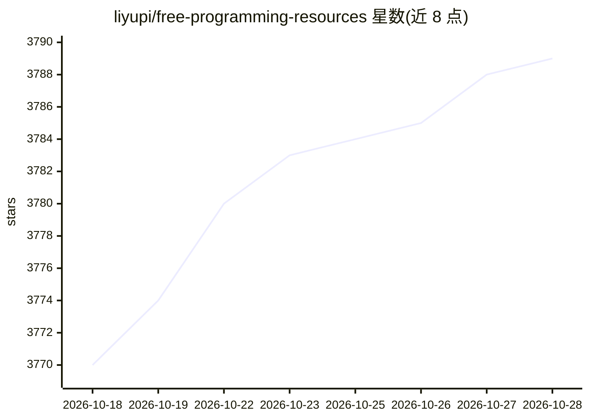

# liyupi/free-programming-resources

⭐ 3,789 · HTML · MIT · 推送 2026-03-23 · [GitHub](https://github.com/liyupi/free-programming-resources) · [官网](http://dogyupi.com) · 个人维护 · 中文 README

**免费编程学习资源导航清单：学习路线、项目教程、面试题与 AI 资源**

由程序员鱼皮维护的编程资源聚合清单，按学习、做项目、求职面试、学 AI 四个板块组织：100+ 编程学习路线、30+ 项目教程、简历模板、1w+ 面试真题、500+ AI 资源与提示词合集等。README 声明仓库内文档资源已不再维护，内容迁移至其运营的线上平台（编程导航、鱼皮 AI 导航、面试鸭）。面向程序员与计算机专业学生，MIT 协议。

## 筛选速览

| 维度 | 判定 | 备注 |
|---|---|---|
| AI 角色 | `ai-knowledge` | 知识聚合/清单类 |
| 许可风险 | `permissive` | MIT |
| 部署形态 | `None` |  |
| 模型依赖 | — | README 未给出锁定关系 |
| 硬件要求 | — | 无带数字的原话,不猜 |
| 安装摩擦 | `low` | 无编译、无系统依赖或容器化 |
| 成熟度 | — | 结构信号不足 |

## 能力要点

- 四板块组织：学编程、做项目、求职、学 AI
- 覆盖 100+ 学习路线与 1w+ 面试真题解析
- AI 板块含项目教程、提示词与 RAG/Agent/MCP 知识库
- 仓库内容已声明迁移至线上平台

## 适用场景

- 找编程入门学习路线和项目实战教程
- 准备技术面试时刷高频面试题与看大厂面经
- 查找 AI 大模型应用开发与 Agent 方向的学习资源

## 场景标签

`精选清单` · 领域:学习与行业

## 证据(README 行号)

> L3: > 让天下编程资源不再难找，帮助更多小伙伴！by 程序员鱼皮，持续更新！
> L8: > 本仓库内的文档资源已不再维护，所有资源均已迁移到线上平台，内容更丰富、更新更及时！请访问以下平台获取最新资源：
> L31: |10+ 最新 AI 商业级项目教程|AI 大模型应用开发、AI Agent、RAG 等前沿方向项目实战|

## 星数曲线

2026-10-18 3,770 → 2026-10-28 3,789（+19）

---
*卡片 v1 · prompt 1.4 · 生成 2026-10-20 · 置信度 high · 依据 README sha `0b2c8695806e` · [字段定义](../../DATASET.md)*
