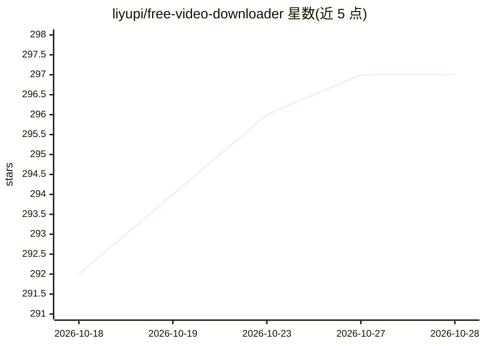

# liyupi/free-video-downloader

⭐ 297 · Vue · 推送 2026-03-23 · [GitHub](https://github.com/liyupi/free-video-downloader) · [官网](https://www.codefather.cn/course/2027618983506640897) · 个人维护 · 中文 README

**教学项目：视频下载器 Web 应用，支持 1800+ 平台与 AI 总结**

程序员鱼皮的付费编程教程配套项目：基于 Vue 3 + FastAPI + yt-dlp + DeepSeek + Stripe 开发的《AI 万能视频下载总结器》。功能包括从 1800+ 平台下载视频（含抖音无水印专用解析模块）、AI 总结摘要（流式输出）、思维导图生成、基于字幕的 AI 问答、SRT/VTT/TXT 字幕导出、JWT 用户认证与会员权限、Stripe 国际支付。本地运行需 Python>=3.10、Node.js>=18、ffmpeg 与 DeepSeek API Key，前后端分别启动。README 附合规使用声明，仅限技术学习与研究用途。

## 筛选速览

| 维度 | 判定 | 备注 |
|---|---|---|
| AI 角色 | `ai-native` | 本体是模型或模型工具 |
| 许可风险 | `none` | — |
| 部署形态 | `library` | 以包/库形式分发 |
| 模型依赖 | locked-api |  |
| 硬件要求 | — | 无带数字的原话,不猜 |
| 安装摩擦 | `medium` | 含编译或系统依赖之一 |
| 成熟度 | — | 结构信号不足 |

## 能力要点

- 基于 yt-dlp 支持 1800+ 网站视频下载，含抖音无水印专用解析模块
- DeepSeek 驱动的 AI 总结摘要（流式输出）与视频问答
- AI 生成思维导图，可导出 PNG/SVG
- JWT 认证 + 会员权限 + Stripe 国际支付

## 适用场景

- 我想下载并备份自己拥有版权的视频到本地
- 看长视频前先用 AI 摘要和思维导图判断是否值得看完整
- 通过跟做该项目学习 AI 编程全流程并充实简历

## 场景标签

`教程课程` `AI 写作` · 领域:内容生成

## 证据(README 行号)

> L21: 这就是 AI 万能视频下载总结器的起点：输入一个视频链接，工具自动解析视频信息，支持从 B 站、YouTube、抖音等 **1800+** 平台下载视频，同时提供 **AI 视频总结**（摘要 + 思维导图 + 问答），还集成了 
> L35: 2）AI 视频总结摘要：自动提取字幕并调用 DeepSeek 大模型进行内容分析，流式输出视频的总结摘要，Markdown 格式排版精美，帮助用户快速了解视频核心要点。

## 星数曲线

2026-10-18 292 → 2026-10-28 297（+5）

---
*卡片 v1 · prompt 1.4 · 生成 2026-10-21 · 置信度 high · 依据 README sha `8f3a4fa02896` · [字段定义](../../DATASET.md)*
