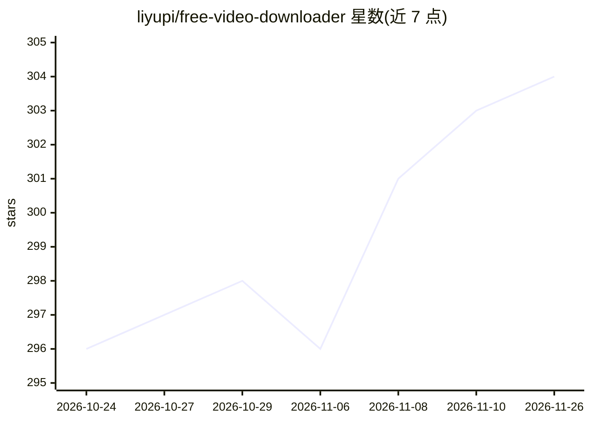

# liyupi/free-video-downloader

⭐ 304 · Vue · 推送 2026-11-23 · [GitHub](https://github.com/liyupi/free-video-downloader) · [官网](https://www.codefather.cn/course/2027618983506640897) · 组织维护 · 中文 README

**面向学习者的视频下载加 AI 总结全栈教学项目**

由程序员鱼皮与编程导航团队开发的开源全栈教学项目（产品名 SaveAny）：前端 Vue 3 + Tailwind CSS，后端 Python FastAPI，基于 yt-dlp 解析 1800+ 音视频站点下载，提取字幕送入 DeepSeek 生成流式摘要、交互式思维导图与上下文问答，并集成 JWT 用户认证、免费额度控制与 Stripe Webhook 支付回调。仓库含前后端源码与两份 SEO/GEO 优化文档，配套课程教程，定位于掌握 AI 编程全流程的教学实战。

## 筛选速览

| 维度 | 判定 | 备注 |
|---|---|---|
| AI 角色 | `ai-native` | 本体是模型或模型工具 |
| 许可风险 | `none` | — |
| 部署形态 | `library` | 以包/库形式分发 |
| 模型依赖 | locked-api |  |
| 硬件要求 | — | 无带数字的原话,不猜 |
| 安装摩擦 | `medium` | 含编译或系统依赖之一 |
| 成熟度 | — | 结构信号不足 |

## 能力要点

- 基于 yt-dlp 覆盖 1800+ 平台视频解析下载，支持清晰度与格式选择
- DeepSeek 生成流式摘要、思维导图与基于字幕的 AI 问答
- JWT 用户认证、免费额度控制与 Stripe Webhook 自动开通 VIP
- 附赠 GEO 与 SEO 优化实战文档

## 适用场景

- 粘贴视频链接一键下载并生成 AI 总结与思维导图
- 导出 SRT/VTT/TXT 字幕用于笔记整理
- 作为出海 SaaS 收款与会员体系的参考模板
- 跟着课程学习 AI 编程全栈开发流程

## 场景标签

`教程课程` `AI 写作` · 领域:内容生成

## 证据(README 行号)

> L3: 基于 Vue 3、Python FastAPI、yt-dlp、DeepSeek 与 Stripe 打造的开源商业级 AI 万能视频下载与总结网站，由 程序员鱼皮 与编程导航团队以 Vibe Coding 方式原创开发，支持 1800
> L37: 后端基于开源利器 `yt-dlp` 覆盖超过 1800 个主流音视频站点（涵盖 B 站、YouTube、抖音等常见平台），支持自由选择清晰度与封装格式，并借助 FFmpeg 自动完成音视频合流。针对抖音等解析规则较为特殊的平台，项
> L43: 系统会自动提取视频对应的字幕或文本信息并送入 DeepSeek 大模型进行深度分析，通过 SSE 流式协议实时输出排版清晰、重点突出的 Markdown 总结报告，帮助你几分钟内掌握长视频的核心干货。

## 星数曲线

2026-10-24 296 → 2026-11-26 304（+8）

---
*卡片 v1 · prompt 1.4 · 生成 2026-11-25 · 置信度 high · 依据 README sha `9ca0d50da28e` · [字段定义](../../DATASET.md)*
