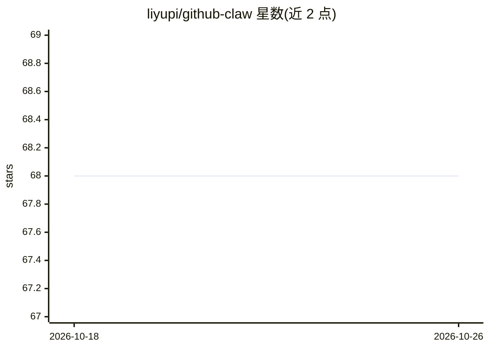

# liyupi/github-claw

⭐ 68 · Python · 推送 2026-04-21 · [GitHub](https://github.com/liyupi/github-claw) · [官网](https://ai.codefather.cn) · 个人维护 · 中文 README

**以 GitHub 仓库为载体的 AI Agent 工作空间模板：长期记忆+技能包+自动化**

一套开箱即用的 AI Agent 工作空间模板：以 GitHub 仓库为载体，用文件（MEMORY.md、每日日志、任务追踪）跨对话保留 AI 上下文实现长期记忆；将 UI/UX 设计、AI 图片生成、SEO 审计等能力封装为存放于 .agents/skills/ 的标准化技能包（主入口 SKILL.md）；通过 GitHub Actions 实现每日 AI 摘要、Issue 智能分配、自动部署等工作流。使用方式为在 Copilot 对话中让助手读取 AGENTS.md 与 MEMORY.md 恢复状态。仓库内含由该方式孵化的导航网站与多媒体处理平台子项目。

## 筛选速览

| 维度 | 判定 | 备注 |
|---|---|---|
| AI 角色 | `ai-ecosystem` | LLM/agent 周边工具 |
| 许可风险 | `none` | — |
| 部署形态 | `None` |  |
| 模型依赖 | — | README 未给出锁定关系 |
| 硬件要求 | — | 无带数字的原话,不猜 |
| 安装摩擦 | `medium` | 含编译或系统依赖之一 |
| 成熟度 | — | 结构信号不足 |

## 能力要点

- 文件即记忆：MEMORY.md/日志/任务文件实现跨对话长期记忆
- 标准化 Agent 技能包机制（.agents/skills/，内置 3 个技能包）
- GitHub Actions 驱动的每日 AI 摘要、Issue 自动分配与自动部署工作流
- 仓库内含由 Vibe Coding 孵化的子项目（导航站、多媒体处理平台）

## 适用场景

- 搭建一个有长期记忆、跨会话延续工作状态的 AI 协作助手
- 通过技能包机制复用 UI/UX、图片生成、SEO 等能力
- 用 GitHub Actions 实现无人值守的 AI 内容采集与 Issue 处理

## 场景标签

`Agent 记忆` `工作流自动化` `AI 助手` · 领域:Agent 开发

## 证据(README 行号)

> L11: **github-claw** 展示了如何用 GitHub 仓库打造一个**有记忆、有技能、可自动化的 AI 智能体**。它的核心不是某个具体项目，而是一套让 AI 持续工作的机制：
> L32: 技能包（Agent Skill）是本仓库的核心机制——将可复用的 AI 能力封装为标准单元，存放在 `.agents/skills/<skill-name>/`，主入口为 `SKILL.md`，AI 助手接到任务时可直接调用。

## 星数曲线

2026-10-18 68 → 2026-10-26 68（+0）

---
*卡片 v1 · prompt 1.4 · 生成 2026-10-24 · 置信度 high · 依据 README sha `bca4733c7435` · [字段定义](../../DATASET.md)*
