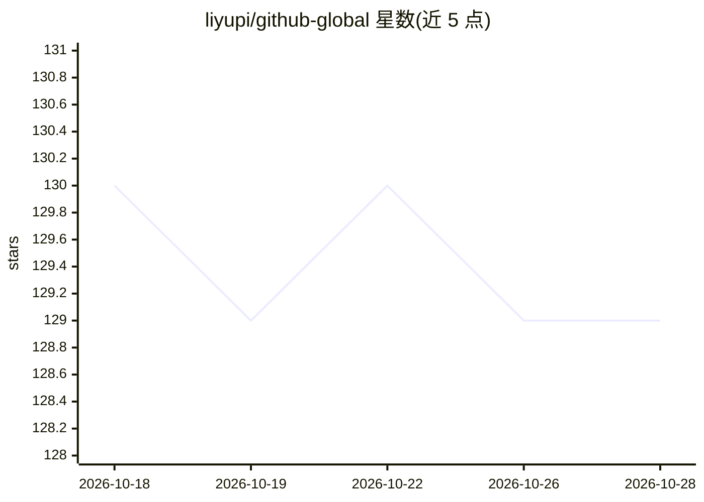

# liyupi/github-global

⭐ 129 · TypeScript · 推送 2026-03-03 · [GitHub](https://github.com/liyupi/github-global) · [官网](https://www.codefather.cn/course/2014303010343092226) · 个人维护 · 中文 README

**教学项目：GitHub 仓库文档 AI 多语言翻译 SaaS 平台**

基于 Next.js + GitHub App + OpenRouter 的仓库文档翻译平台教学项目（编程导航付费教程配套）：输入 GitHub 仓库地址即可由 AI 将文档翻译为最多 20 种语言，翻译完成后自动创建 PR；通过 Webhook 在 Push 时触发增量翻译。支持自定义大模型与 API Key（GPT、Claude、Gemini、DeepSeek 等，经 OpenRouter 接入）。本地运行需 Node.js ≥20、MySQL ≥8.0、GitHub App 与 OpenRouter API Key，提供 Docker Compose 部署方式。项目本体开源，配套视频/文字教程与答疑需付费加入编程导航。

## 筛选速览

| 维度 | 判定 | 备注 |
|---|---|---|
| AI 角色 | `ai-native` | 本体是模型或模型工具 |
| 许可风险 | `none` | — |
| 部署形态 | `self-host` | docker 或自建部署 |
| 模型依赖 | locked-api |  |
| 硬件要求 | — | 无带数字的原话,不猜 |
| 安装摩擦 | `low` | 无编译、无系统依赖或容器化 |
| 成熟度 | — | 结构信号不足 |

## 能力要点

- 输入仓库地址自动多语言翻译并生成 PR（支持 20 种主流语言）
- Webhook 事件驱动的 Push 增量翻译，无需人工干预
- 经 OpenRouter 接入 GPT、Claude、Gemini、DeepSeek 等模型，支持自定义 API Key
- GitHub App OAuth 登录与可视化翻译范围配置

## 适用场景

- 把自己的开源项目文档翻译成多语言版本触达海外用户
- 仓库内容更新后自动增量同步翻译并生成 PR
- 学习 AI 编程全流程与 Next.js + Prisma 全栈开发

## 场景标签

`教程课程` · 领域:学习与行业

## 证据(README 行号)

> L11: 这是一套以 **AI 编程实战** 为核心的项目教程，基于 Next.js + GitHub App + OpenRouter，用 AI 编程的方式从 0 到 1 开发一个《GitHub 仓库 AI 文档翻译 SaaS 平台》，带
> L15: 输入任意一个 GitHub 仓库地址，AI 自动将文档翻译成多种语言，并在基准语言内容发生变更时，**自动增量同步翻译**，生成 PR 等待仓库负责人合并，全程无需人工干预。
> L41: 6）自定义大模型和 API Key，支持 GPT、Claude、Gemini、DeepSeek 等主流模型。

## 星数曲线

2026-10-18 130 → 2026-10-28 129（-1）

---
*卡片 v1 · prompt 1.4 · 生成 2026-10-22 · 置信度 high · 依据 README sha `21119892b2d9` · [字段定义](../../DATASET.md)*
