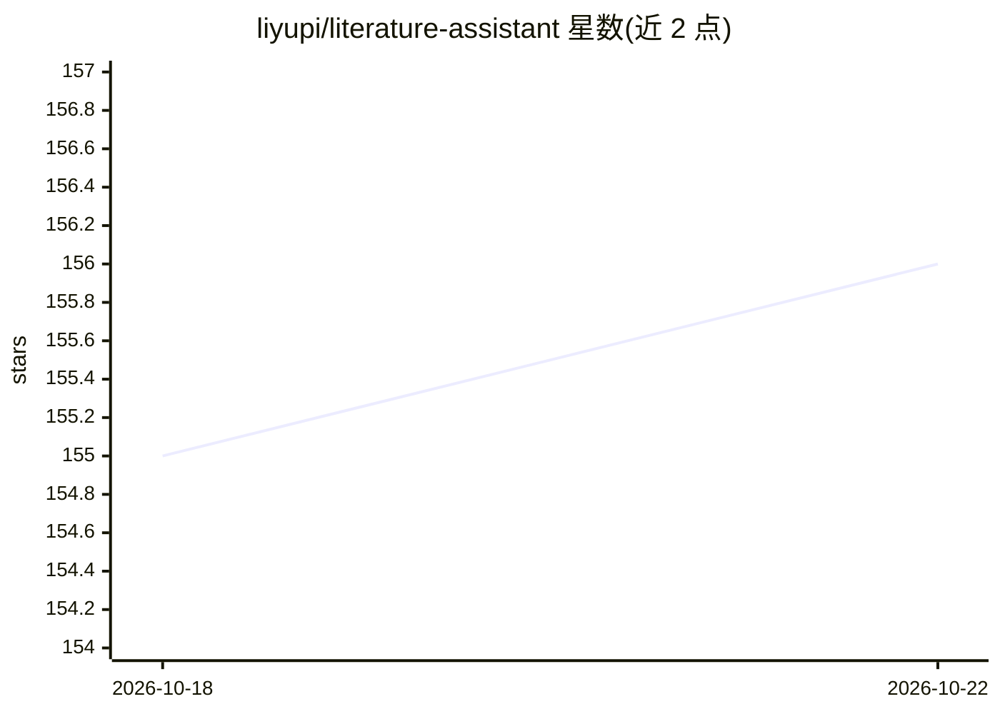

# liyupi/literature-assistant

⭐ 156 · Java · 推送 2025-12-10 · [GitHub](https://github.com/liyupi/literature-assistant) · [官网](https://www.bilibili.com/video/BV1MnpVzdETW) · 个人维护 · 中文 README

**Spring Boot 3 + Vue 的 AI 文献阅读助手后端服务**

基于 Spring Boot 3.5.5 + Java 21 的文献管理后端服务，集成 Kimi AI API：上传 PDF/Word/Markdown 文献后解析内容，自动生成结构化阅读指南与分类标签，支持关键词、标签、文件类型、时间范围等多维度检索，AI 生成过程通过 SSE 实时推送。内置 H2 嵌入式数据库开箱即用，提供启动脚本或 Maven 手动编译两种运行方式，配套 Knife4j API 文档。README 中 AI 功能依赖外部 Kimi API 服务。

## 筛选速览

| 维度 | 判定 | 备注 |
|---|---|---|
| AI 角色 | `ai-native` | 本体是模型或模型工具 |
| 许可风险 | `none` | — |
| 部署形态 | `desktop` | 安装包/桌面程序 |
| 模型依赖 | — | README 未给出锁定关系 |
| 硬件要求 | — | 无带数字的原话,不猜 |
| 安装摩擦 | `medium` | 含编译或系统依赖之一 |
| 成熟度 | — | 结构信号不足 |

## 能力要点

- 支持 PDF/Word/Markdown 上传与内容解析
- 集成 Kimi AI 生成结构化阅读指南与分类标签
- SSE 实时流式推送 AI 生成进度
- 内置 H2 数据库，提供启动脚本一键运行

## 适用场景

- 上传文献后自动获得结构化阅读指南
- 用标签和多维度条件管理检索文献库
- 作为文献管理类 Web 应用的后端服务

## 场景标签

`科研工具` `文档解析` · 领域:知识与检索

## 证据(README 行号)

> L5: 一个基于 Spring Boot 3 + Vue 的现代化文献管理后端服务，集成 AI 技术为用户提供智能文献阅读指南生成、文献管理和检索功能。
> L12: - 🤖 **AI 阅读指南生成**: 集成 Kimi AI，基于文献内容自动生成结构化阅读指南

## 星数曲线

2026-10-18 155 → 2026-10-22 156（+1）

---
*卡片 v1 · prompt 1.4 · 生成 2026-10-22 · 置信度 high · 依据 README sha `2569a1251ba9` · [字段定义](../../DATASET.md)*
