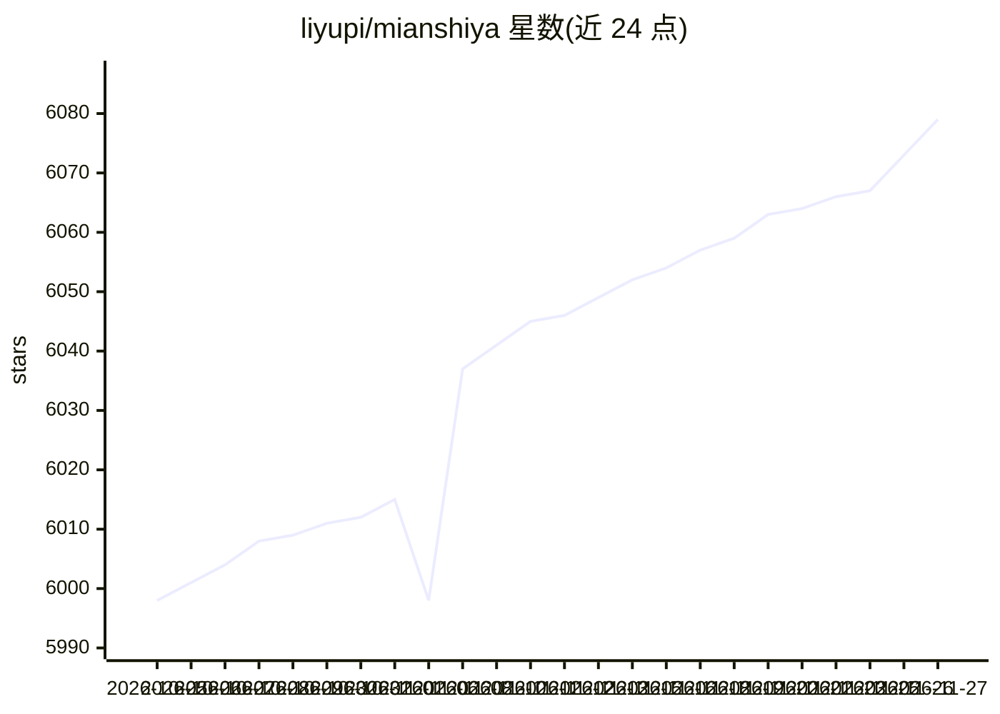

# liyupi/mianshiya

⭐ 6,079 · TypeScript · MIT · 推送 2026-11-23 · [GitHub](https://github.com/liyupi/mianshiya) · [官网](https://www.mianshiya.com) · 组织维护 · 中文 README

**程序员面试题库平台：题解+刷题路线+多端刷题**

面试鸭是程序员面试刷题平台，按岗位与考点整理 300+ 题库、1w+ 道高频真题，题解由大厂面试官参与打磨，结构为「回答重点+扩展知识」。支持网页、微信小程序、JetBrains IDE 插件、VSCode 插件四端同步，提供刷题路线、专项练习、面经收录、语音读题等功能。线上版采用免费浏览+会员解锁全部题解的模式。本仓库为 2022 年开源版全栈代码（React + Node.js/云开发），线上版本已另行迭代。

## 筛选速览

| 维度 | 判定 | 备注 |
|---|---|---|
| AI 角色 | `ai-enhanced` | 去掉 AI 部分产品仍成立 |
| 许可风险 | `permissive` | MIT |
| 部署形态 | `self-host` | docker 或自建部署 |
| 模型依赖 | — | README 未给出锁定关系 |
| 硬件要求 | — | 无带数字的原话,不猜 |
| 安装摩擦 | `low` | 无编译、无系统依赖或容器化 |
| 成熟度 | `idea` | |

## 能力要点

- 300+ 题库、1w+ 道企业高频面试真题与原创题解
- 网页 / 微信小程序 / JetBrains IDE 插件 / VSCode 插件四端同步刷题
- 按工作年限规划的刷题路线与专项选择题自测、错题本
- 开源版为 React + Node.js/腾讯云开发全栈项目，含前台与后台

## 适用场景

- 备战实习、校招、社招的系统化刷题
- 转型 AI 应用开发方向时了解面试考点
- 学习全栈项目开发（阅读 2022 开源版代码）
- 面试前用面多多进行 AI 模拟面试演练

## 场景标签

 · 领域:教育/求职与技术学习

## 证据(README 行号)

> L168: > 本仓库是面试鸭 **2022 年开源版本** 的完整代码，为 React + 云开发 / Node.js 全栈项目，包含网站前台和管理员后台的前后端代码，适合学习全栈项目开发。
> L248: 面试鸭的所有题库和题目都可以免费浏览，部分题解也免费开放。开通会员后，可以解锁全部 1w+ 道题目的原创题解，并使用专项练习、沉浸式刷题、语音读题、发布回答讨论等会员功能。网页端和小程序会员通用。详见 面试鸭会员权益。
> L327: |面多多|面试鸭旗下 AI 模拟面试工具，支持沉浸式综合面试、专项面试和简历押题|

## 星数曲线

2026-10-25 5,998 → 2026-11-27 6,079（+81）

---
*卡片 v1 · prompt 1.4 · 生成 2026-11-25 · 置信度 mid · 依据 README sha `ba8ec06df9cc` · [字段定义](../../DATASET.md)*
