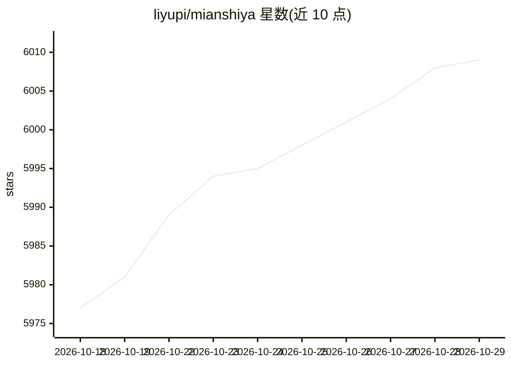

# liyupi/mianshiya

⭐ 6,009 · TypeScript · MIT · 推送 2026-02-04 · [GitHub](https://github.com/liyupi/mianshiya) · [官网](https://www.mianshiya.com) · 个人维护 · 中文 README

**面试刷题网站：程序员一站式在线刷题看题解备战求职**

React + Umi 前端、Node.js（Express）/ 腾讯云云开发后端的全栈面试刷题网站，包含网站前台与管理员后台完整代码。功能覆盖题目浏览与多维筛选排序、搜索收藏、共同编辑解析、一键组卷下载试卷、回答点赞、积分排行榜等，面向求职者、面试官、学生与老师。技术栈含 MongoDB、Redis、Elasticsearch，支持 Docker 部署。题目内容涵盖 Java、前端、AI 大模型、RAG 等方向，AI 仅是题库主题之一，非产品功能。

## 筛选速览

| 维度 | 判定 | 备注 |
|---|---|---|
| AI 角色 | `ai-knowledge` | 知识聚合/清单类 |
| 许可风险 | `permissive` | MIT |
| 部署形态 | `self-host` | docker 或自建部署 |
| 模型依赖 | — | README 未给出锁定关系 |
| 硬件要求 | — | 无带数字的原话,不猜 |
| 安装摩擦 | `low` | 无编译、无系统依赖或容器化 |
| 成熟度 | — | 结构信号不足 |

## 能力要点

- 题目多维筛选排序、搜索收藏与共同编辑解析
- 试题篮一键组卷、下载试卷、语音读卷（试验）
- React + Node.js / 云开发双后端形态，含管理员后台
- Docker 容器部署支持

## 适用场景

- 求职者一站式在线刷高频面试题看题解
- 面试官快速选题、一键生成试卷
- 学习 React + Node.js + 云开发的全栈项目实现

## 场景标签

 · 领域:教育/求职内容平台

## 证据(README 行号)

> L5: > 一个干净免费的面试刷题网站！
> L7: > 开源版为 React + 云开发 / Node.js 全栈项目，包含网站前台 + 管理员后台的完整前后端代码。

## 星数曲线

2026-10-18 5,977 → 2026-10-29 6,009（+32）

---
*卡片 v1 · prompt 1.4 · 生成 2026-10-20 · 置信度 mid · 依据 README sha `3100f0d22265` · [字段定义](../../DATASET.md)*
