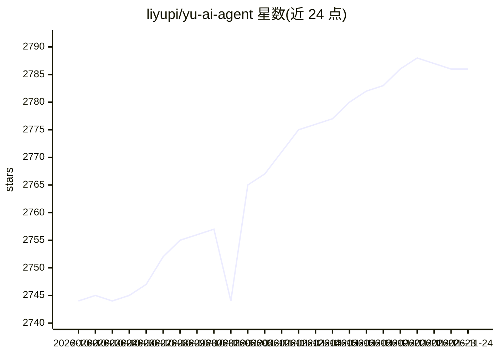

# liyupi/yu-ai-agent

⭐ 2,790 · Java · 推送 2026-11-23 · [GitHub](https://github.com/liyupi/yu-ai-agent) · [官网](https://www.codefather.cn) · 个人维护 · 中文 README

**Java 后端开发者的 AI 智能体实战教学项目**

由程序员鱼皮/编程导航团队出品的 Spring Boot 3 + Java 21 + Spring AI 教学实战项目，包含 AI 恋爱大师问答应用、基于 ReAct 模式的 YuManus 自主规划智能体，以及独立的图片搜索 MCP 服务端。覆盖大模型接入、Ollama 本地部署、Prompt 工程、对话记忆、RAG 知识库与 PgVector 向量检索、Tool Calling、MCP、SSE 流式与 Serverless 部署。配套 9 期课程视频教程、文字笔记与面试题解，定位于 Java 工程师向 AI 应用开发转型学习。

## 筛选速览

| 维度 | 判定 | 备注 |
|---|---|---|
| AI 角色 | `ai-ecosystem` | LLM/agent 周边工具 |
| 许可风险 | `none` | — |
| 部署形态 | `self-host` | docker 或自建部署 |
| 模型依赖 | local-ok | 支持本地模型 |
| 硬件要求 | — | 无带数字的原话,不猜 |
| 安装摩擦 | `low` | 无编译、无系统依赖或容器化 |
| 成熟度 | — | 结构信号不足 |

## 能力要点

- 基于 ReAct 模式的自主规划智能体 YuManus（OpenManus Java 实现）
- RAG 知识库全链路：ETL 切分、PgVector 存储、检索调优与幻觉治理
- 独立图片搜索 MCP 服务端模块（Pexels 接口）
- 支持 Ollama 本地大模型部署与阿里云百炼云端接入

## 适用场景

- Java 后端工程师系统学习 Spring AI 与智能体开发
- 毕业设计延伸开发垂直行业 AI 智能体
- 参考其 RAG/MCP 开发范式迁移到企业文档问答系统

## 场景标签

`教程课程` `RAG` · 领域:知识与检索

## 证据(README 行号)

> L67: 本项目以 Java 21、Spring Boot 3 和 Spring AI 框架为核心，同时兼顾 LangChain4j 的对比实战，融合向量检索、协议扩展、前端交互与 Serverless 部署等全栈技术栈，帮助你建立完整的企
> L74: |智能体与协议扩展|ReAct Agent 自主规划引擎、Tool Calling 工具调用、MCP 模型上下文协议（独立图片搜索服务端）|

## 星数曲线

2026-10-22 2,744 → 2026-11-24 2,786（+42）

---
*卡片 v1 · prompt 1.4 · 生成 2026-11-24 · 置信度 high · 依据 README sha `8526f27ef00e` · [字段定义](../../DATASET.md)*
