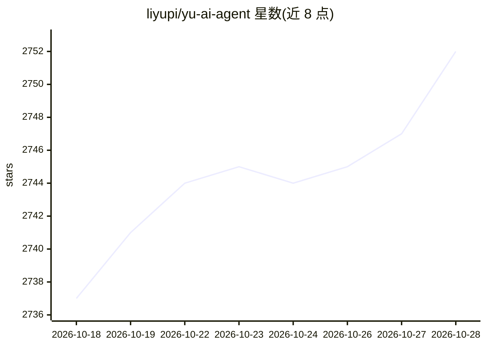

# liyupi/yu-ai-agent

⭐ 2,755 · Java · 推送 2026-01-07 · [GitHub](https://github.com/liyupi/yu-ai-agent) · [官网](https://www.codefather.cn) · 个人维护 · 中文 README

**面向程序员的 AI 应用开发实战教程：恋爱大师应用与 ReAct 智能体**

程序员鱼皮的付费教学项目，以 Java 21 + Spring Boot 3 + Spring AI / LangChain4j 为技术栈，带学员开发 AI 恋爱大师应用（多轮对话、RAG 知识库、Tool Calling、MCP 服务调用）和基于 ReAct 模式的自主规划智能体 YuManus。教程分 9 期，覆盖大模型接入（含 Ollama 本地部署）、Prompt 工程、PgVector 向量数据库、MCP 协议、智能体构建与 Serverless 部署，并提供简历写法与面试题解。完整视频教程需加入编程导航会员获取。

## 筛选速览

| 维度 | 判定 | 备注 |
|---|---|---|
| AI 角色 | `ai-knowledge` | 知识聚合/清单类 |
| 许可风险 | `none` | — |
| 部署形态 | `None` |  |
| 模型依赖 | local-ok | 支持本地模型 |
| 硬件要求 | — | 无带数字的原话,不猜 |
| 安装摩擦 | `medium` | 含编译或系统依赖之一 |
| 成熟度 | — | 结构信号不足 |

## 能力要点

- AI 恋爱大师应用：多轮对话 + RAG 知识库 + 工具调用 + MCP 服务
- 基于 ReAct 模式自主实现 Manus 类智能体 YuManus
- 9 期学习大纲覆盖 Spring AI、RAG、Tool Calling、MCP、智能体、Serverless
- 附带简历写法、面试题解与答疑服务

## 适用场景

- 跟随教程学习 Spring AI 与 AI 应用全栈开发
- 为求职简历增加 AI 项目实战经历
- 学习 RAG、工具调用、MCP 与智能体的实现原理

## 场景标签

`教程课程` `RAG` · 领域:知识与检索

## 证据(README 行号)

> L5: > 本项目为教学项目，提供完整视频教程 + 文字教程 + 简历写法 + 面试题解 + 答疑服务，帮你提升项目能力，给简历增加亮点！
> L13: 这是一套以 **AI 开发实战** 为核心的项目教程，将通过开发 **AI 恋爱大师应用 + 拥有自主规划能力的超级智能体**，带大家掌握新时代程序员必知必会的 AI 核心概念、AI 实用工具、AI 编程技术、AI 框架原理、AI
> L25: 鱼皮给大家讲的都是 **通用的项目开发方法和架构设计套路**，从这个项目中你将学到：

## 星数曲线

2026-10-18 2,737 → 2026-10-28 2,752（+15）

---
*卡片 v1 · prompt 1.4 · 生成 2026-10-21 · 置信度 high · 依据 README sha `00973cbcdbe4` · [字段定义](../../DATASET.md)*
