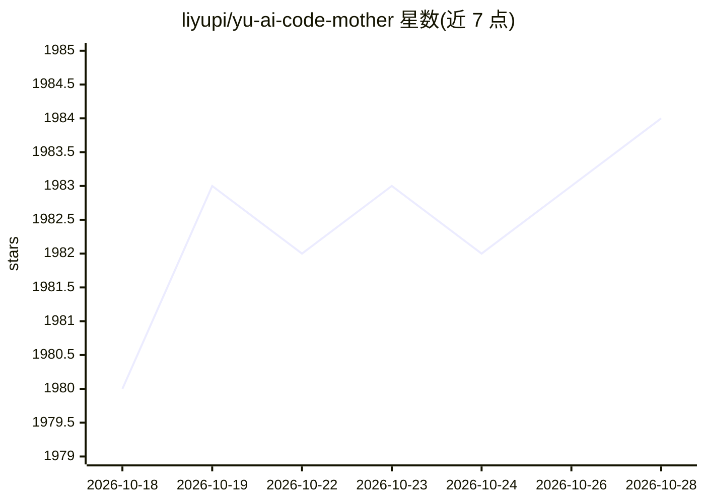

# liyupi/yu-ai-code-mother

⭐ 1,985 · Java · 推送 2026-09-12 · [GitHub](https://github.com/liyupi/yu-ai-code-mother) · [官网](https://www.codefather.cn/course/1948291549923344386) · 组织维护 · 中文 README

**面向求职者的 AI 代码生成平台教学项目（Spring Boot 3 + LangChain4j）**

程序员鱼皮的付费教学项目：带学员从 0 到 1 开发一个基于 Spring Boot 3 + LangChain4j + Vue 3 的企业级 AI 零代码应用生成平台，功能包括智能代码生成（AI 分析需求并工具调用生成代码、流式输出）、可视化编辑对话改页面、一键云端部署分享、用户/应用/监控等后台管理。技术覆盖 LangGraph4j 工作流、Tool Calling、Spring Cloud 微服务、Redis+Caffeine 多级缓存、监控体系等。README 为课程营销页，未给出安装运行命令，需加入编程导航付费获取完整教程。

## 筛选速览

| 维度 | 判定 | 备注 |
|---|---|---|
| AI 角色 | `ai-knowledge` | 知识聚合/清单类 |
| 许可风险 | `none` | — |
| 部署形态 | `None` |  |
| 模型依赖 | — | README 未给出锁定关系 |
| 硬件要求 | — | 无带数字的原话,不猜 |
| 安装摩擦 | `low` | 无编译、无系统依赖或容器化 |
| 成熟度 | — | 结构信号不足 |

## 能力要点

- 智能代码生成：AI 选择策略、工具调用生成代码文件、流式输出
- 可视化编辑模式：选择网页元素并与 AI 对话修改页面
- 一键部署到云端并自动截图，支持源码下载
- 教程覆盖 LangChain4j / LangGraph4j / Spring Cloud 微服务 / 多级缓存 / 监控体系

## 适用场景

- 想通过实战项目学习 AI 应用与微服务架构的求职者
- 需要简历项目亮点与面试题解的开发者
- 学习 AI 智能体、工作流与企业级后端架构设计

## 场景标签

`教程课程` `代码生成` · 领域:编码与开发

## 证据(README 行号)

> L5: > 本项目为教学项目，提供完整视频教程 + 文字教程 + 简历写法 + 面试题解 + 答疑服务，帮你提升项目能力，给简历增加亮点！
> L13: 这是一套以 **AI 开发实战 + 后端架构设计** 为核心的项目教程，基于 Spring Boot 3 + LangChain4j + Vue 3 开发对标大厂的 **企业级 AI 代码生成平台**，带大家掌握新时代程序员必知必
> L97: 🧧 助力新项目学习，给大家发放 **限时编程导航优惠券**，扫码即可领券加入。加入三天内不满意可全额退款，欢迎加入体验，名额有限，速来学习！

## 星数曲线

2026-10-18 1,980 → 2026-10-28 1,984（+4）

---
*卡片 v1 · prompt 1.4 · 生成 2026-10-21 · 置信度 high · 依据 README sha `fb4573d7fdc4` · [字段定义](../../DATASET.md)*
