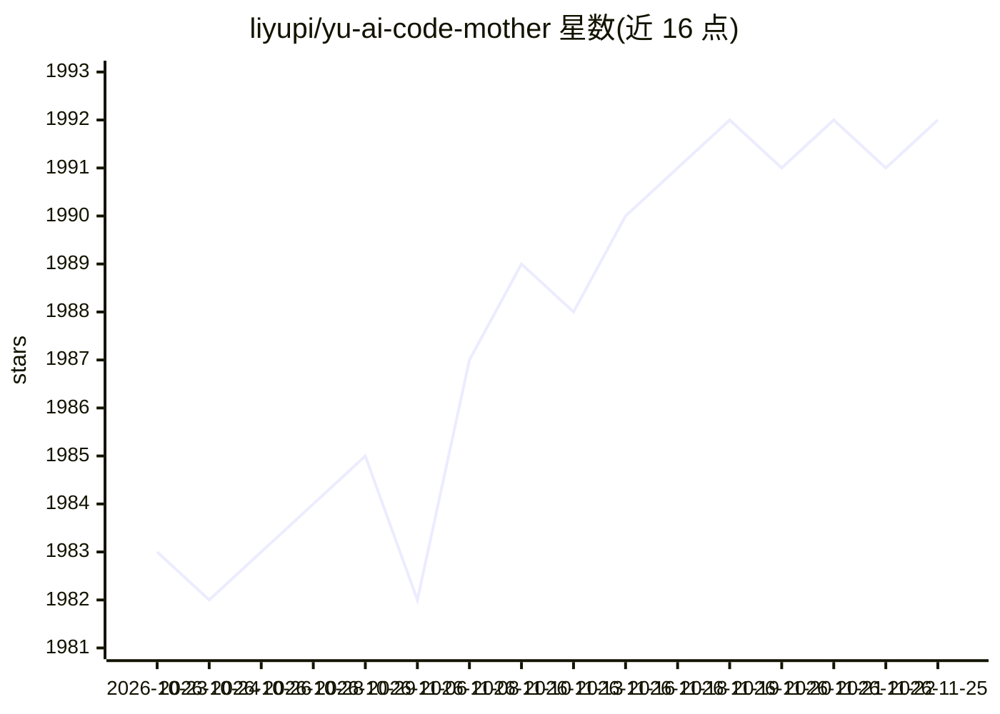

# liyupi/yu-ai-code-mother

⭐ 1,992 · Java · 推送 2026-11-23 · [GitHub](https://github.com/liyupi/yu-ai-code-mother) · [官网](https://www.codefather.cn/course/1948291549923344386) · 组织维护 · 中文 README

**面向开发者的开源 AI 零代码应用生成平台**

基于 Spring Boot 3、LangChain4j、LangGraph4j 与 Vue 3 的平台：用户输入自然语言需求，系统经智能路由、Tool Calling 与多节点工作流生成可运行的前后端代码，支持可视化点选编辑、实时预览、Selenium 自动截图、一键云端部署与源码下载。同时提供单体与 Spring Cloud Alibaba/Dubbo 微服务两套代码版本，集成 MySQL、Redis+Caffeine 多级缓存与 Prometheus/Grafana 监控。README 定位为教学实战项目，完整教程需通过编程导航课程获取，仓库内未给出独立安装运行步骤。

## 筛选速览

| 维度 | 判定 | 备注 |
|---|---|---|
| AI 角色 | `ai-native` | 本体是模型或模型工具 |
| 许可风险 | `none` | — |
| 部署形态 | `None` |  |
| 模型依赖 | — | README 未给出锁定关系 |
| 硬件要求 | — | 无带数字的原话,不猜 |
| 安装摩擦 | `medium` | 含编译或系统依赖之一 |
| 成熟度 | — | 结构信号不足 |

## 能力要点

- 自然语言经 AI 智能路由与多节点工作流流式生成前后端代码
- 可视化点选元素并结合 AI 对话完成局部修改
- 生成应用一键云端部署并自动截取封面图
- 同时保留单体版与 Spring Cloud Alibaba/Dubbo 微服务版源码

## 适用场景

- 用一句自然语言生成可直接预览和部署的网站应用
- 学习 LangChain4j/LangGraph4j 编排 AI Agent 工作流
- 参考微服务拆分与监控体系搭建企业级 AI 平台
- 作为毕业设计或求职简历的实战项目素材

## 场景标签

`代码生成` `教程课程` · 领域:编码与开发

## 证据(README 行号)

> L3: 基于 Spring Boot 3、LangChain4j、LangGraph4j 与 Vue 3 打造的开源企业级 AI 零代码应用生成平台，由 程序员鱼皮 与编程导航团队原创出品，对标大厂 AI 代码生成产品，支持自然语言流式生成
> L17: `yu-ai-code-mother` 是一套将「企业级 AI 应用开发」与「大厂级后端架构设计」深度融合的全栈微服务实战项目。项目以 Spring Boot 3、LangChain4j、LangGraph4j 和 Vue 3 为
> L125: |AI 框架与工作流|LangChain4j、LangGraph4j、DeepSeek 等大模型接入、AI 智能路由、Tool Calling|

## 星数曲线

2026-10-23 1,983 → 2026-11-25 1,992（+9）

---
*卡片 v1 · prompt 1.4 · 生成 2026-11-24 · 置信度 high · 依据 README sha `425f413c4f64` · [字段定义](../../DATASET.md)*
