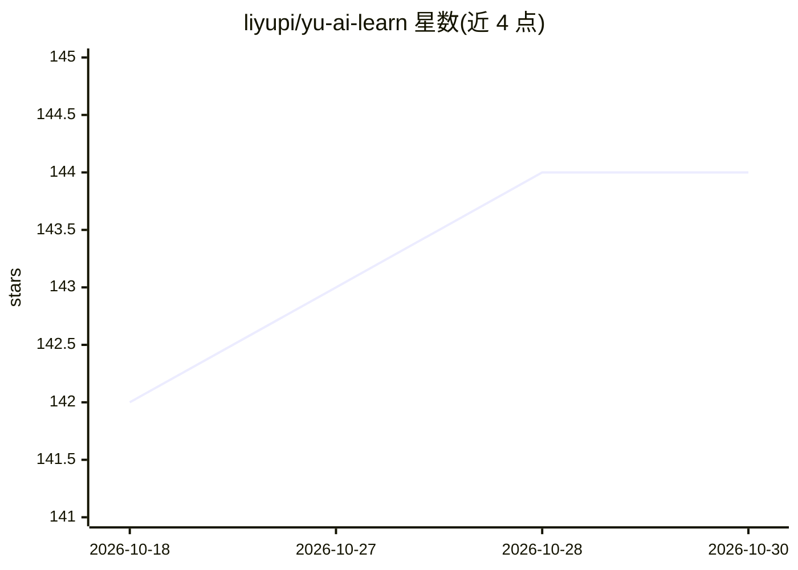

# liyupi/yu-ai-learn

⭐ 144 · Python · MIT · 推送 2026-08-11 · [GitHub](https://github.com/liyupi/yu-ai-learn) · [官网](https://www.codefather.cn/course/2037104890135748610) · 个人维护 · 中文 README

**AI 闯关学习微信小程序教学项目：一句话出题、闯关答题与复盘**

程序员鱼皮的编程实战教程项目，配套视频/文字教程与答疑服务，从 0 到 1 开发一个微信小程序：用户输入一句话或上传文档，AI 联网搜索（Tavily）并经 LangGraph ReAct Agent 生成闯关题目，答完即时判分讲解，通关后生成 AI 复盘报告；支持 PDF/Word/Markdown 文本 RAG 出题（Chroma 向量库）、通义千问文生图配图转存腾讯云 COS、微信静默登录与 JWT。技术栈为 Taro + FastAPI + LangChain/LangGraph + DeepSeek，Docker 部署到微信云托管。教程与完整源码需加入编程导航会员获取。

## 筛选速览

| 维度 | 判定 | 备注 |
|---|---|---|
| AI 角色 | `ai-knowledge` | 知识聚合/清单类 |
| 许可风险 | `permissive` | MIT |
| 部署形态 | `self-host` | docker 或自建部署 |
| 模型依赖 | locked-api |  |
| 硬件要求 | — | 无带数字的原话,不猜 |
| 安装摩擦 | `low` | 无编译、无系统依赖或容器化 |
| 成熟度 | — | 结构信号不足 |

## 能力要点

- 一句话/文本/网址起题，LangGraph ReAct Agent 自主决定联网搜索（Tavily）
- 私有文档 RAG 出题：解析、分块、向量化存入 Chroma
- AI 复盘报告：掌握度评分、薄弱知识点与学习建议
- 通义千问文生图配图 + 腾讯云 COS 永久链接，带额度与并发控制

## 适用场景

- 跟学一套 AI 应用开发到部署上线的完整流程
- 把项目骨架复用到企业培训考核、题库复习等垂直场景
- 学习 LangChain/LangGraph 编排与 RAG 知识库实现

## 场景标签

`教程课程` `RAG` · 领域:知识与检索

## 证据(README 行号)

> L5: > 本项目为教学项目，提供完整视频教程 + 文字教程 + 简历写法 + 面试题解 + 答疑服务，帮你提升项目能力，给简历增加亮点！
> L11: 这是一套以 **AI 编程实战** 为核心的项目教程，基于 Taro + Python FastAPI + LangChain + LangGraph + DeepSeek，用 AI 编程的方式从 0 到 1 开发一个《AI 闯关

## 星数曲线

2026-10-18 142 → 2026-10-30 144（+2）

---
*卡片 v1 · prompt 1.4 · 生成 2026-10-22 · 置信度 mid · 依据 README sha `20ea2d7aa2f2` · [字段定义](../../DATASET.md)*
