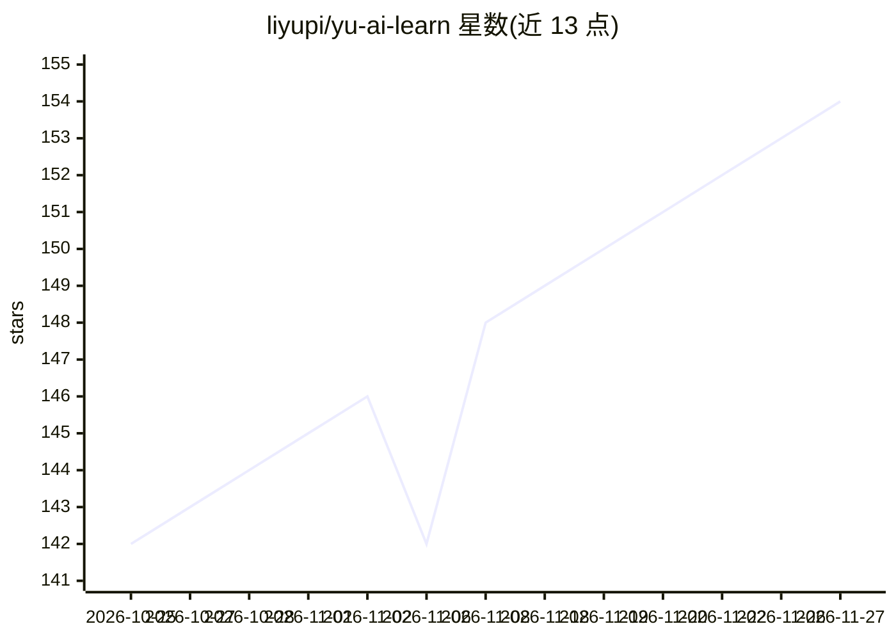

# liyupi/yu-ai-learn

⭐ 154 · Python · MIT · 推送 2026-11-23 · [GitHub](https://github.com/liyupi/yu-ai-learn) · [官网](https://www.codefather.cn/course/2037104890135748610) · 组织维护 · 中文 README

**全栈教学项目：AI 闯关答题微信小程序（Taro+FastAPI+DeepSeek）**

以「AI 编程实战 + 小程序上线」为核心的开源全栈教学项目：用户输入一句话主题或上传私有文档，后端通过 LangGraph ReAct 智能体结合 Tavily 联网检索，或经 Chroma 向量库做 RAG 检索增强，由 DeepSeek 生成结构化题目，支持闯关判分、即时讲解、通义千问文生图配图与通关复盘报告。仓库保留 OpenSpec 规范文档与 UI 原型，配套编程导航付费视频课程，核心流程本地仅需 DeepSeek API Key 与 MySQL 即可跑通。

## 筛选速览

| 维度 | 判定 | 备注 |
|---|---|---|
| AI 角色 | `ai-native` | 本体是模型或模型工具 |
| 许可风险 | `permissive` | MIT |
| 部署形态 | `self-host` | docker 或自建部署 |
| 模型依赖 | locked-api |  |
| 硬件要求 | — | 无带数字的原话,不猜 |
| 安装摩擦 | `low` | 无编译、无系统依赖或容器化 |
| 成熟度 | — | 结构信号不足 |

## 能力要点

- LangGraph ReAct 智能体联网搜索出题（Tavily）
- 私有文档 RAG 知识库出题（Chroma 向量库，支持 PDF/Word/Markdown/TXT）
- 通义千问文生图配图转存腾讯云 COS，含每日额度限制
- 后端 Dockerfile 适配微信云托管部署，附 ICP 备案与类目申请流程说明

## 适用场景

- 作为全栈 + AI 编程实战教学项目跟学跑通
- 作毕业设计或迁移到驾考、企业培训等垂直答题场景
- 为学习任意主题生成闯关题目并边答边学

## 场景标签

`教程课程` `RAG` · 领域:知识与检索

## 证据(README 行号)

> L17: `yu-ai-learn` 是一套以「AI 编程实战 + 小程序产品上线」为核心的全栈开源项目，基于 Taro 4、React 18、Python FastAPI、LangChain、LangGraph 与 DeepSeek 构建
> L132: |大模型 / 检索|DeepSeek（出题 / 报告）· 阿里云百炼（Embedding / 文生图）· Tavily（联网搜索）|
> L164: |DeepSeek API Key|必需|驱动 AI 出题与通关复盘报告生成|

## 星数曲线

2026-10-25 142 → 2026-11-27 154（+12）

---
*卡片 v1 · prompt 1.4 · 生成 2026-11-27 · 置信度 high · 依据 README sha `db1735744caf` · [字段定义](../../DATASET.md)*
