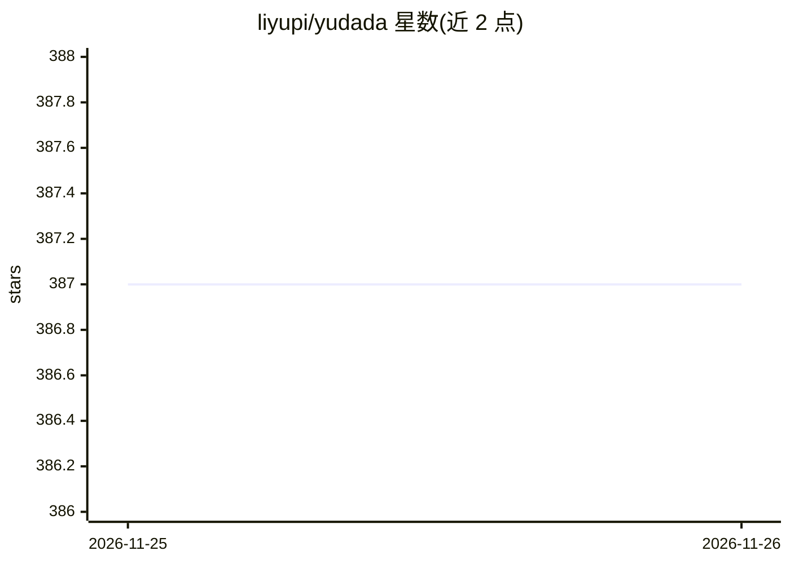

# liyupi/yudada

⭐ 387 · Java · 推送 2026-11-23 · [GitHub](https://github.com/liyupi/yudada) · [官网](https://yudada.code-nav.cn) · 个人维护 · 中文 README

**给全栈开发者的 AI 答题/测评应用平台**

三端分离的开源全栈项目：React+Taro 小程序、Vue 3 Web 前端、Spring Boot 后端。创作者可自定义题目与评分策略发布测评应用，或输入主题由 AI 生成题目；用户答题后获得规则引擎或大模型生成的分析报告，管理员负责审核与统计。AI 部分封装通用模块并讲解 Prompt 设计与 Spring AI 整合；配套四阶段课程教程与优化实践（SSE 流式推送、多级缓存、分库分表、幂等设计）。完整教学视频需加入编程导航解锁。

## 筛选速览

| 维度 | 判定 | 备注 |
|---|---|---|
| AI 角色 | `ai-native` | 本体是模型或模型工具 |
| 许可风险 | `none` | — |
| 部署形态 | `None` |  |
| 模型依赖 | — | README 未给出锁定关系 |
| 硬件要求 | — | 无带数字的原话,不猜 |
| 安装摩擦 | `low` | 无编译、无系统依赖或容器化 |
| 成熟度 | — | 结构信号不足 |

## 能力要点

- AI 一键生成题目与答题后流式 AI 智能评分报告
- RxJava + SSE 流式推送缩短 AI 出题等待时间
- Caffeine + Redis 缓存与 Redisson 分布式锁防缓存击穿
- ShardingSphere 分库分表与雪花 ID 幂等设计

## 适用场景

- 发布 MBTI 测评、面试小测等答题应用并分享给用户作答
- 输入主题让 AI 自动生成整套题目
- 作为 Java+Vue 全栈毕业设计或求职项目练手

## 场景标签

`教程课程` · 领域:学习与行业

## 证据(README 行号)

> L23: `yudada`（鱼答答）是由 程序员鱼皮 打造的一款深入真实业务场景的企业级开源全栈 AI 答题应用平台。项目融合 Vue 3、Arco Design、React Taro 跨端小程序、Java Spring Boot、Redi
> L25: 在鱼答答平台上，创作者既可以通过自定义题目和评分策略发布各类性格测评或知识问答应用，也能直接输入主题借助 AI 一键生成题目；普通用户可以检索并扫码分享感兴趣的应用，在线完成答题后即时获取基于规则引擎或大模型生成的专属分析总结；平
> L47: 第三阶段引入智谱 ChatGLM 大模型打造 `AI 智能答题应用平台`。创作者只需指定主题，即可由 AI 自动生成高质量题目；用户答题完成后由 AI 深度解析答案并输出个性化评估报告。课程中还会系统封装通用 AI 模块并深入讲解

## 星数曲线

2026-11-25 387 → 2026-11-26 387（+0）

---
*卡片 v1 · prompt 1.4 · 生成 2026-11-24 · 置信度 high · 依据 README sha `70a8dfa8dbae` · [字段定义](../../DATASET.md)*
