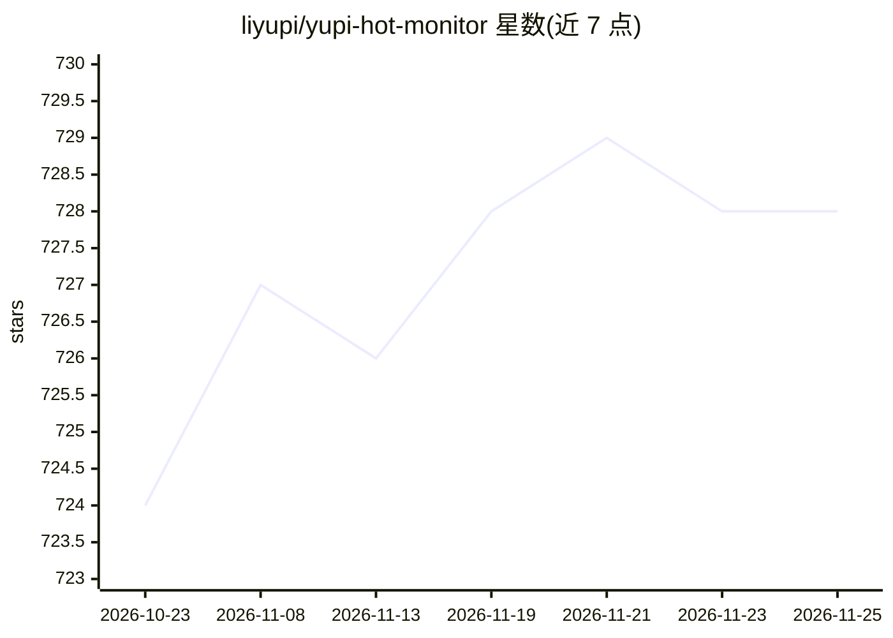

# liyupi/yupi-hot-monitor

⭐ 728 · TypeScript · 推送 2026-11-23 · [GitHub](https://github.com/liyupi/yupi-hot-monitor) · [官网](https://www.codefather.cn/course/2026625439052627970) · 组织维护 · 中文 README

**给信息追踪者的多平台 AI 热点监控与聚合工具**

基于 Node.js、Express 5、React 19 与 OpenRouter 的全栈热点监控工具：用户配置关键词后，定时任务从 Twitter、Bing、HackerNews、搜狗、B 站等 8+ 信息源抓取内容，经大模型完成查询扩展、真假识别、相关性评分与摘要，并通过 Socket.io 实时推送和邮件通知。热点监控能力另封装为 Agent Skills 技能包，可在 Cursor、VSCode Copilot、Claude Code 中调用。数据层为 Prisma + SQLite，需 OpenRouter API Key 方可运行核心 AI 功能。项目同时是编程导航的教学实战课程配套仓库。

## 筛选速览

| 维度 | 判定 | 备注 |
|---|---|---|
| AI 角色 | `ai-native` | 本体是模型或模型工具 |
| 许可风险 | `none` | — |
| 部署形态 | `library` | 以包/库形式分发 |
| 模型依赖 | locked-api |  |
| 硬件要求 | — | 无带数字的原话,不猜 |
| 安装摩擦 | `low` | 无编译、无系统依赖或容器化 |
| 成熟度 | — | 结构信号不足 |

## 能力要点

- 8+ 信息源聚合抓取，Axios + Cheerio 实现
- OpenRouter 接入大模型完成查询扩展、真假识别与相关性评分
- Socket.io 实时推送与邮件通知
- 热点监控能力封装为标准 Agent Skills 技能包

## 适用场景

- 自动追踪大模型发布与开源项目动态并推送提醒
- 按关键词多维度筛选排序追热点、找选题
- 在 AI 编程工具中用自然语言调用热点抓取与汇总

## 场景标签

`教程课程` `网页抓取` · 领域:效率与自动化

## 证据(README 行号)

> L3: 基于 Node.js、Express 5、React 19、OpenRouter 与 Socket.io 构建的开源全网 AI 热点监控工具，由 程序员鱼皮 与编程导航团队以 Vibe Coding 方式原创打造，支持 8+ 平台聚
> L41: 后端定时任务会自动从 8 个以上国内外主流信息源聚合采集内容，并通过 OpenRouter 接入大模型自动完成查询扩展（Query Expansion）、信息真假辨别、主题相关性评分以及要点提炼，把杂乱的原始网页转化为结构化的高价
> L121: 本地运行本项目只需准备好两项条件：安装 Node.js 18 及以上版本（推荐使用 20 LTS），并提前申请一个 OpenRouter API Key（必需，用于驱动大模型的查询扩展、真假识别与相关性分析）。

## 星数曲线

2026-10-23 724 → 2026-11-25 728（+4）

---
*卡片 v1 · prompt 1.4 · 生成 2026-11-25 · 置信度 high · 依据 README sha `b613c5bfc653` · [字段定义](../../DATASET.md)*
