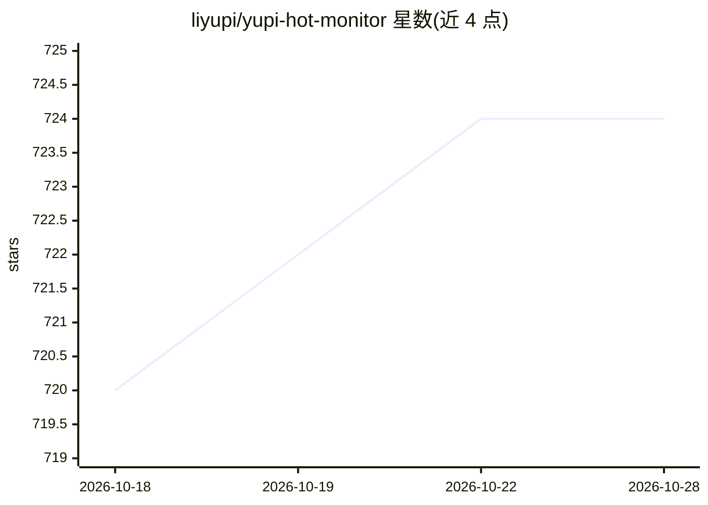

# liyupi/yupi-hot-monitor

⭐ 724 · TypeScript · 推送 2026-04-16 · [GitHub](https://github.com/liyupi/yupi-hot-monitor) · [官网](https://www.codefather.cn/course/2026625439052627970) · 组织维护 · 中文 README

**教学向全栈项目：多源热点聚合监控工具，AI 分析与通知**

编程导航的教学项目，以 AI 编程实战教程形式提供一套热点监控工具的源码与教程：配置关键词后从 Twitter、Bing、HackerNews、搜狗、B 站等 8+ 信息源聚合抓取，经 OpenRouter 接入大模型做查询扩展、真假识别、相关性分析与摘要，通过 Socket.io 实时推送并支持邮件通知；监控能力另封装为 Agent Skills 技能包供 Cursor、VSCode Copilot、Claude Code 使用。技术栈为 Express 5 + React 19 + Prisma/SQLite。运行需 Node.js ≥ 18 与自备 OpenRouter API Key；完整教程与答疑服务需付费加入编程导航。

## 筛选速览

| 维度 | 判定 | 备注 |
|---|---|---|
| AI 角色 | `ai-native` | 本体是模型或模型工具 |
| 许可风险 | `none` | — |
| 部署形态 | `library` | 以包/库形式分发 |
| 模型依赖 | locked-api |  |
| 硬件要求 | — | 无带数字的原话,不猜 |
| 安装摩擦 | `low` | 无编译、无系统依赖或容器化 |
| 成熟度 | — | 结构信号不足 |

## 能力要点

- 8+ 信息源聚合抓取 + AI 查询扩展与真假识别
- Socket.io 实时推送 + 邮件通知
- 热点监控能力封装为 Agent Skills 技能包，兼容 Cursor / VSCode Copilot / Claude Code
- Express 5 + React 19 + Prisma/SQLite 全栈实现

## 适用场景

- 我想让 AI 自动盯某个关键词的全网热点并及时通知我
- 学习 AI 编程从 0 到 1 开发全栈工具的完整流程
- 在 Cursor / Claude Code 中以 Agent Skills 方式复用热点监控能力

## 场景标签

`教程课程` `网页抓取` · 领域:效率与自动化

## 证据(README 行号)

> L11: 这是一套以 **AI 编程实战** 为核心的项目教程，基于 Express 5 + React 19 + OpenRouter + Socket.io，用 AI 编程的方式从 0 到 1 开发一个《AI 热点监控工具》，带你亲身体
> L15: 输入要监控的关键词，系统自动从 Twitter、Bing、HackerNews、搜狗、B 站等 **8+** 个信息源聚合抓取内容，利用 AI 进行真假识别和相关性分析，并通过 WebSocket 实时推送和邮件通知用户。此外，还
> L29: 2）AI 自动从 8+ 数据源抓取和分析热点，利用 AI 进行查询扩展、真假识别、相关性分析和智能摘要。

## 星数曲线

2026-10-18 720 → 2026-10-28 724（+4）

---
*卡片 v1 · prompt 1.4 · 生成 2026-10-21 · 置信度 mid · 依据 README sha `12645858ba69` · [字段定义](../../DATASET.md)*
