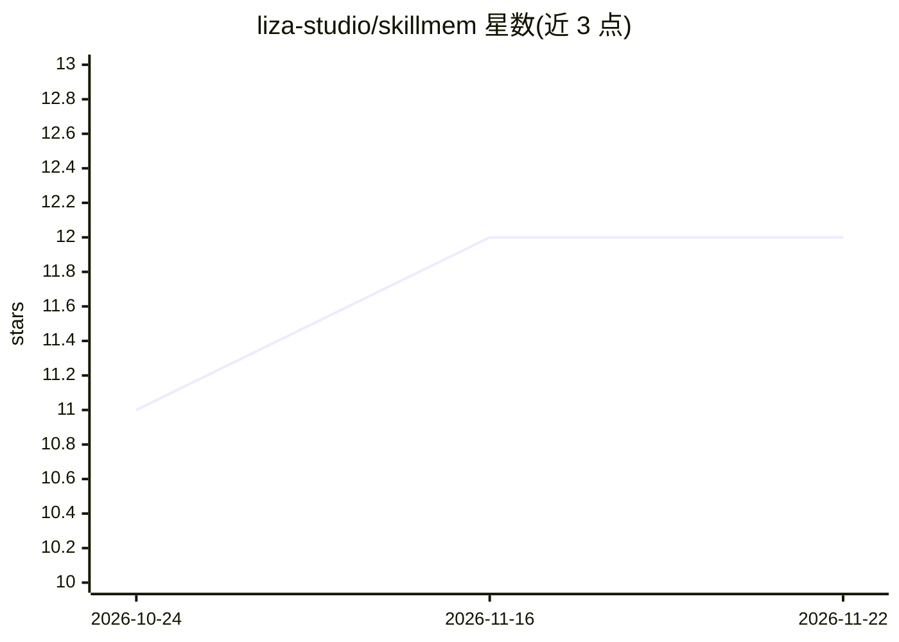

# liza-studio/skillmem

⭐ 12 · Python · Apache-2.0 · 推送 2026-11-08 · [GitHub](https://github.com/liza-studio/skillmem) · [官网](https://skillmem.dev) · 个人维护

**给编码 agent 的本地自改进技能记忆层：学习、召回、衰减**

为 Claude Code、Codex CLI 等 6 个编码 agent 提供本地持久化的技能与记忆层：任务完成后 agent 将做法记录为技能，下次任务前自动召回；技能强度只在外部证据（如测试通过）时上升，长期不用的按遗忘曲线衰减并归档。每条记忆带来源（owner/agent/imported/derived），未经所有者批准的内容以数据块注入，编辑历史用 SHA256 哈希链防篡改。纯本地 SQLite + FTS5 + ONNX 嵌入，无 API key、无云调用，多 agent 共享同一数据库并记录作者。

## 筛选速览

| 维度 | 判定 | 备注 |
|---|---|---|
| AI 角色 | `ai-ecosystem` | LLM/agent 周边工具 |
| 许可风险 | `permissive` | Apache-2.0 |
| 部署形态 | `self-host` | docker 或自建部署 |
| 模型依赖 | — | README 未给出锁定关系 |
| 硬件要求 | `cpu-ok` | |
| 安装摩擦 | `low` | 无编译、无系统依赖或容器化 |
| 成熟度 | — | 结构信号不足 |

## 能力要点

- 双语混合检索：FTS5 BM25 + ONNX 多语言嵌入，全 CPU 离线运行
- 强度只由外部证据提升（test-witness 钩子验证测试通过），自报无效
- 来源记录与所有者信任机制：未批准记忆以数据而非指令注入
- SHA256 哈希链编辑历史，skillmem verify 可检测篡改

## 适用场景

- 让 Claude Code 跨会话记住项目操作步骤与教训
- 多个编码 agent（Claude Code 与 Codex）共享同一份技能库
- 本地离线环境下管理 agent 记忆而不上传数据

## 场景标签

`Agent 记忆` · 领域:Agent 开发

## 证据(README 行号)

> L15: skillmem gives Claude Code and the Codex CLI a local, persistent skill & memory layer. After every non-trivial task
> L22: - **Deep Claude Code integration** — hooks on six events + 9 MCP tools installed with one command.
> L67: |**Where it runs**|your disk. SQLite + FTS5 + a local ONNX embedding model. No API key, no cloud, no Docker, no gra

## 星数曲线

2026-10-24 11 → 2026-11-22 12（+1）

---
*卡片 v1 · prompt 1.4 · 生成 2026-11-18 · 置信度 mid · 依据 README sha `33ba8c971440` · [字段定义](../../DATASET.md)*
