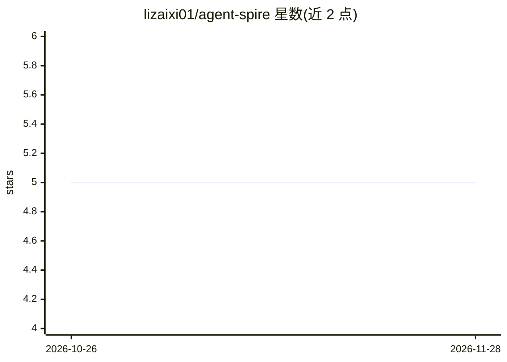

# lizaixi01/agent-spire

⭐ 5 · TypeScript · 推送 2026-10-17 · [GitHub](https://github.com/lizaixi01/agent-spire) · [官网](https://lizaixi01.github.io/agent-spire/) · 个人维护 · 中文 README

**用像素卡牌爬塔游戏学习 AI Agent 工程知识**

以李博杰《深入理解 AI Agent》教材为内容底本的浏览器端单人卡牌爬塔教学游戏：十章知识对应十幕共 90 层，73 张可升级卡牌、三种角色构筑，配套 60 道情境题与 90 道 Python 工程题（地狱模式），题目附提示与逐项解析，知识图鉴保留章节与页码。完全在浏览器本地运行，不调用大模型、无需 API 密钥或后端；游玩包 10 MiB 上限，需 Node.js 启动本地服务，仓库暂未授予统一开源许可。

## 筛选速览

| 维度 | 判定 | 备注 |
|---|---|---|
| AI 角色 | `ai-knowledge` | 知识聚合/清单类 |
| 许可风险 | `none` | — |
| 部署形态 | `None` |  |
| 模型依赖 | — | README 未给出锁定关系 |
| 硬件要求 | — | 无带数字的原话,不猜 |
| 安装摩擦 | `low` | 无编译、无系统依赖或容器化 |
| 成熟度 | — | 结构信号不足 |

## 能力要点

- 十章九十层爬塔流程，覆盖 ReAct、RAG、MCP、评估、多 Agent 协作等主题
- 60 道入门情境题与 90 道 Python 工程题（地狱模式），带提示与解析
- 完全本地离线运行，不调用大模型，无需账号或 API 密钥
- 固定种子可复现远征，浏览器本地自动存档

## 适用场景

- 以游戏化方式预习或复习 AI Agent 设计原理与工程实践
- 无编程基础时通过情境题理解 Agent 核心概念
- 离线环境下自学 Agent 知识图鉴并按难度练习

## 场景标签

`教程课程` · 领域:学习与行业

## 证据(README 行号)

> L5: 可离线游玩的像素风单人卡牌爬塔游戏。以李博杰《深入理解 AI Agent：设计原理与工程实践》为教材，把十章知识变成一场九十层的远征。
> L21: - **逐章探索。** 从 ReAct、上下文工程、RAG、工具与 MCP，一路走到评估、后训练、持续进化和多 Agent 协作。知识图鉴保留章节与页码。
> L26: 游戏完全在浏览器本地运行，不调用大模型，无需账号、API 密钥或后端服务。卡面由 SVG 绘制，音频由 Web Audio 合成。

## 星数曲线

2026-10-26 5 → 2026-11-28 5（+0）

---
*卡片 v1 · prompt 1.4 · 生成 2026-11-21 · 置信度 high · 依据 README sha `b09c6e36c418` · [字段定义](../../DATASET.md)*
