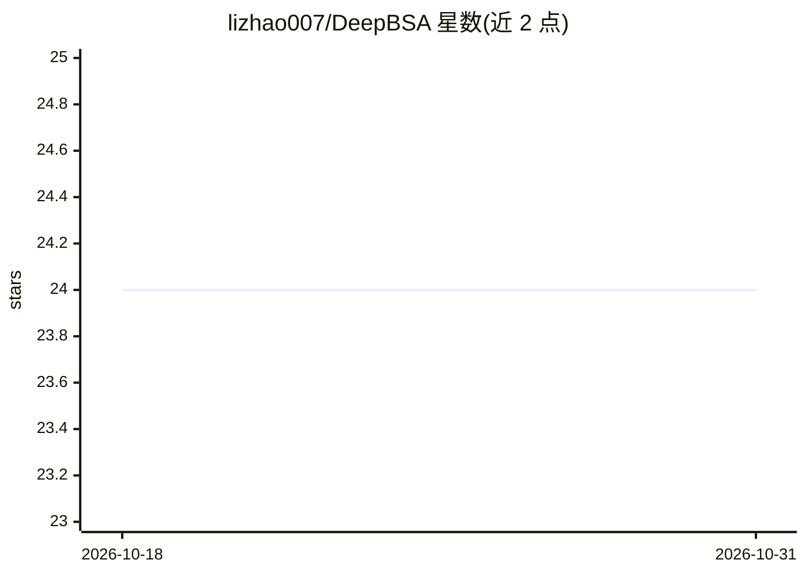

# lizhao007/DeepBSA

⭐ 24 · 推送 2026-05-15 · [GitHub](https://github.com/lizhao007/DeepBSA) · 组织维护 · 中文 README

**混池分离分析（BSA）软件：用深度学习等7种算法定位复杂性状QTL**

面向遗传育种的BSA分析桌面软件：内置自研深度学习（DL）与k-value两种新算法，并集成ED4、delta SNP_index、G'、Ridit、SmoothLOD五种常用算法，适用于至少2个混池的定位分析。输入VCF文件（建议GATK流程出变异），输出定位结果PDF与算法值CSV。提供Windows与Linux版本下载（Linux版已停更），Linux运行需R与Python3.7+。配套论文发表于Mol. Plant。

## 筛选速览

| 维度 | 判定 | 备注 |
|---|---|---|
| AI 角色 | `ai-native` | 本体是模型或模型工具 |
| 许可风险 | `none` | — |
| 部署形态 | `None` |  |
| 模型依赖 | — | README 未给出锁定关系 |
| 硬件要求 | — | 无带数字的原话,不猜 |
| 安装摩擦 | `low` | 无编译、无系统依赖或容器化 |
| 成熟度 | — | 结构信号不足 |

## 能力要点

- 自研深度学习（DL）与k-value算法，适用于≥2个混池
- 集成ED4/delta SNP_index/G'/Ridit/SmoothLOD五种算法
- 输入VCF，输出定位结果PDF与算法值CSV
- Windows/Linux 双平台，无需复杂生信技能的一体化流程

## 适用场景

- 对混池测序VCF数据做QTL定位分析
- 对比多种BSA算法的定位结果
- 育种群体复杂性状的基因位点剖析

## 场景标签

 · 领域:生物信息学/遗传育种

## 证据(README 行号)

> L2: DeepBSA is a novel bulked segregant analysis (BSA) software for the dissection of complex traits. Two brand-new algo
> L51: Li Z., Chen X., Shi S., Zhang H., Wang X., Chen H., Li W., and Li L. (2022). DeepBSA: A deep-learning algorithm imp

## 星数曲线

2026-10-18 24 → 2026-10-31 24（+0）

---
*卡片 v1 · prompt 1.4 · 生成 2026-10-27 · 置信度 high · 依据 README sha `692644d80a09` · [字段定义](../../DATASET.md)*
